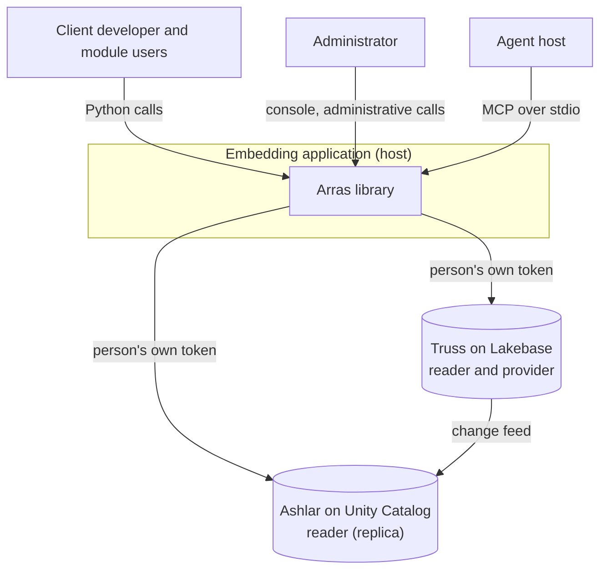
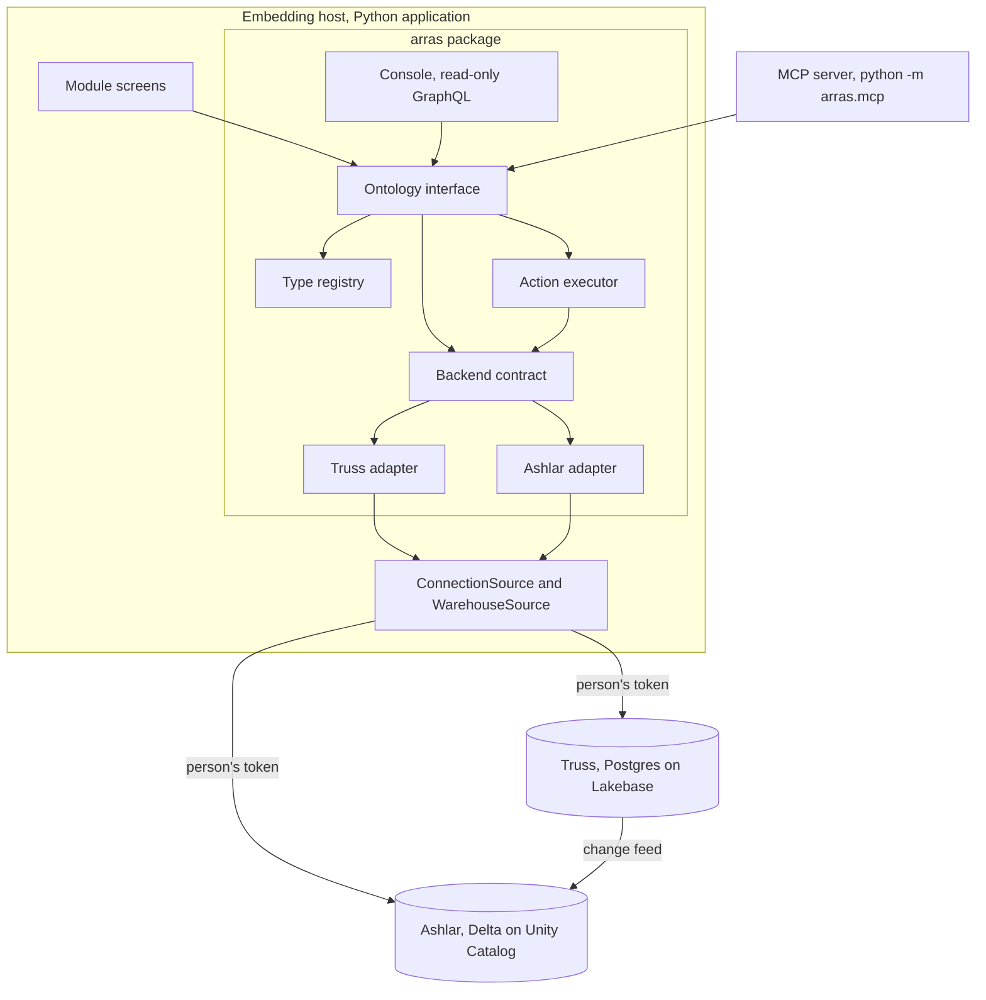
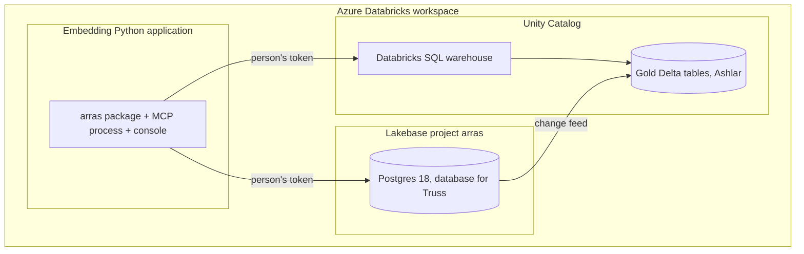
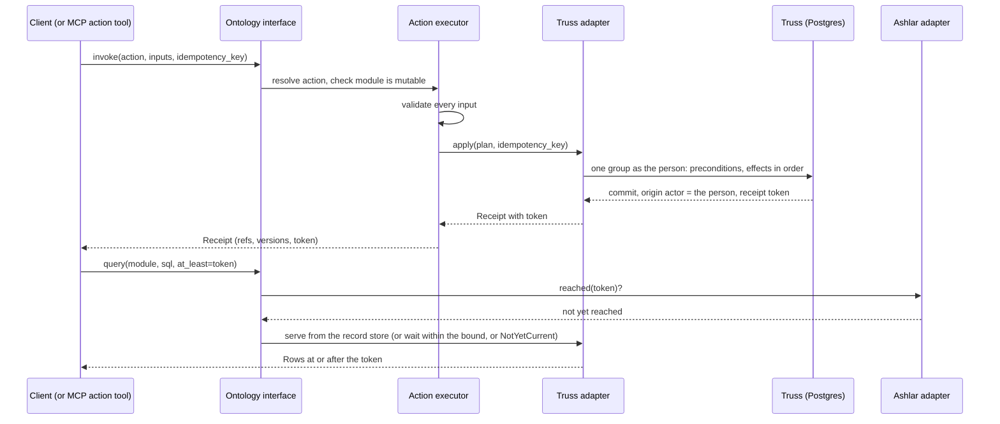

---
ddx:
  id: architecture
  type: architecture
  activity: design
  status: draft
  owner: Erik LaBianca
  updated: 2026-10-12
  authoring:
    home: repo
  links:
    - id: prd
      kind: informed_by
    - id: principles
      kind: informed_by
    - id: SPIKE-002
      kind: informed_by
    - id: SPIKE-005
      kind: informed_by
    - id: ADR-005
      kind: constrained_by
    - id: ADR-006
      kind: informs
    - id: ADR-011
      kind: informs
    - id: ADR-012
      kind: informs
    - id: ADR-013
      kind: informs
    - id: ADR-014
      kind: informs
    - id: ADR-015
      kind: informs
    - id: ADR-016
      kind: informs
    - id: ADR-017
      kind: informs
    - id: CONTRACT-001
      kind: informs
    - id: CONTRACT-002
      kind: informs
    - id: CONTRACT-003
      kind: informs
    - id: CONTRACT-004
      kind: informs
    - id: CONTRACT-005
      kind: informs
    - id: CONTRACT-006
      kind: informs
    - id: CONTRACT-007
      kind: informs
    - id: CONTRACT-008
      kind: informs
    - id: ADR-018
      kind: informs
    - id: ADR-019
      kind: informs
    - id: ADR-020
      kind: informs
    - id: CONTRACT-009
      kind: informs
    - id: ADR-021
      kind: informs
---

# Architecture

## Scope

This architecture covers Arras, the interface through which applications read and change the ontology. Arras is a Python 3.11 library embedded by a host application, with a stdio MCP binding (MCP, the Model Context Protocol, is Anthropic's open protocol for agent tools) and a read-only administration console. Any number of named backends sit behind it, each with the roles reader (serves graph reads) and/or provider (applies actions); the host's placement says, per module, which is its record store (system of record, serves `latest`), which are replicas (serve `bulk`) and which provider applies each action (CONTRACT-002). The diagrams below illustrate the intended Truss/Ashlar deployment, not a qualified production deployment of both adapters:

- Truss, an open-source, UMF-driven property-graph engine on SQL databases. It runs on Lakebase (Databricks managed Postgres), holds the mutable modules and is a reader and provider (the Truss adapter).
- Ashlar, an open-source toolkit for property-graph ontologies on a warehouse. It holds the full ontology in gold Delta tables on Unity Catalog (Databricks' governance layer for tables and access) and is a reader fed from the providers' stores (the Ashlar adapter).

The current package implements the Truss adapter and in-memory store/replica backends. The memory backends serve tests, the sandbox and the dev host. The Ashlar reader adapter and its integration/feed qualification remain planned.

UMF (the metamodel, owned by DocumentDrivenDX, that defines Arras's types and actions) defines every type and action.

Outside this architecture:

- The storage layout, journal and change feed of each store, which its project owns (ADR-013).
- The embedding host internals, the end-user screens of any module, and the provisioning of Lakebase resources, role grants and Unity Catalog access (the host platform's own provisioning).
- Structure derived from sensitive source records, which ADR-005 gates.
- Writes to a replica, which changes only through the feed from the providers' stores, and actions that span backends (PRD, Non-Goals).

The design is driven by the PRD's P0 requirements (FR-1 to FR-3, FR-6, FR-9 to FR-11, FR-14 to FR-23, FR-28 to FR-31, FR-38, FR-44 to FR-46 and FR-47) and by the twelve client interactions drafted in `client-interactions-draft.md`.

## Level 1: System Context

| Element | Type | Purpose | Protocol |
|---------|------|---------|----------|
| Client developer and module users | User | Declare types and actions in UMF, read, invoke actions; correct catalog records through the catalog screens | Python calls on the `arras` package, through the embedding host |
| Administrator and module developer | User | Browse what the ontology holds in the console; run registration and imports as the administrative principal, and install and module access on the installing connection | GraphQL over HTTP (console); Python calls (administrative) |
| Builder and administrator | User | Browse the schema, read data, invoke declared actions and read the audit trail in the Operator Console | JSON over HTTP (CONTRACT-009) and GraphQL (CONTRACT-006), through `arras-ui` |
| Host application | External | Hosts Arras, supplies per-person connection sources, hands each person's token to the library and to the MCP process | Python import of the public names in `arras.__all__`; local stdio for MCP |
| Agent host | External | Lists and calls Arras's MCP tools for one signed-in person; classifies each tool by name | MCP over stdio |
| Truss on Lakebase | External | Reader and provider: the fresh system of record for the mutable modules | Postgres wire protocol, one connection per person, authenticated with that person's token |
| Ashlar on Unity Catalog | External | Full ontology, bounded `bulk` reads, fed from Truss | Databricks SQL warehouse, with the person's token |
| UMF, Truss, Ashlar and Weft maintainers (DocumentDrivenDX) | External | Own the metamodel, the engines and the SQL language and compiler (Weft) the backends host | Requests to each project |



## Level 2: Container Diagram

| Container | Technology | Responsibilities | Communication |
|-----------|------------|------------------|---------------|
| Arras library (`arras` package) | Python 3.11, `uv`; psycopg 3 and Truss in the optional extra `truss` | The ontology interface (`describe`, `query`, `validate`, `invoke`, `invoke_batch`, `import_records`, `registry`), the type registry, action execution, the backend contract and its adapters (Truss, Ashlar, memory), per-backend status, the Truss lifecycle (install-or-verify, explicit upgrade, module access) | In-process calls from the host; per-person connections to Truss and the warehouse |
| MCP server (`python -m arras.mcp`) | Python 3.11 process on the library, MCP over stdio | Translates MCP tools to library calls for one person; the only code that reads configuration files or the environment | stdio frames on stdout, logs on stderr; one process per signed-in person |
| Administration console (`arras.console.create_app`) | graphql-core on a thin ASGI handler, GraphiQL page (ADR-011, proposed) | Read-only GraphQL generated from the registry; every resolver is one `query` call | HTTP, `POST /graphql` and `POST /graphql/{module}`, mounted by the host |
| Operator surface (`arras.operate.create_app`) | A thin ASGI handler over the library's `validate`, `invoke`, `invoke_batch`, `changes` and `loads` (ADR-021, proposed) | JSON binding of declared actions and audit reads; no write other than invoking a declared action; the host may apply its own per-action approval | HTTP, mounted by the host (CONTRACT-009) |
| Operator Console UI (`arras-ui`, `ui/`) | React, TypeScript, Vite, Tailwind, TanStack Query, host-replaceable design system (ADR-021, ADR-029) | One interface in two modes: Explore, the instance tool (search, entity pages, edits, New, Retire, an Actions menu and History, for operators), and Operate, the model and platform tool (Model, Entities, Graph, Actions, Changes and Query), under one shell, named by a `brand`; embedded in the embedding host or hosted standalone | HTTP to the console and operator surfaces only |
| Truss backend | Postgres 18 on Lakebase, project `arras` (the required target); PostgreSQL 18.6 through `pgserver-pg18` (a test-only group) locally and in CI | System of record for the modules placed on it; Truss's own install, module isolation by role grants, retained history (Truss's contracts; it offers no journal read, so the audit reads are `Unsupported`) | Postgres wire protocol, per person |
| Ashlar backend | Gold Delta tables on Unity Catalog, read through a Databricks SQL warehouse | Full ontology; bounded `bulk` reads; applies Unity Catalog row and column policy to the user | Databricks SQL, per person |
| The embedding host | Python app on Databricks Apps, Python 3.11 or later | Supplies `ConnectionSource` and `WarehouseSource`, names the administrative principal and the installing connection, owns end-user screens, pooling and credential refresh | Python calls; per-new-connection credentials (the host's connection-lifecycle policy) |



## Level 3: Component Diagram

The library needs internal structure here because the backend contract is the boundary that makes adapters interchangeable.

| Component | Container | Purpose | Notes |
|-----------|-----------|---------|-------|
| Ontology interface | Arras library | `Arras.start`, `session(principal)`, `describe`, `query`; routes each read by the named module's placement and consistency level and attaches freshness | Synchronous in v1 (CONTRACT-001); refuses a call with no token before any backend is contacted |
| Query hand-off | Arras library | Chooses the serving backend and consistency, then passes the Weft statement and parameters to it unparsed; owns no SQL grammar | `Unsupported` carries Weft's construct and what the backend declares |
| Weft compile and execute | The serving backend (Truss through its Weft compiler boundary; Ashlar likewise) | Compiles the statement against its modules, executes it with the principal's token, builds no statement by string concatenation | Weft refusal becomes `Unsupported` |
| Type registry | Arras library | Accepts UMF documents as revisions on the record store, holds the host's placement (record store, replicas and providers per module), reports the ontology revision (a map keyed by backend name) and capabilities | Refuses unsupported UMF constructs, naming them (CONTRACT-002) |
| Action executor | Arras library | Validates inputs and preconditions, resolves effects, calls `apply`, `apply_batch` or `import_records` on the action's provider, returns receipts | Effects are a closed list; a module-bound handler returns effects and never writes (CONTRACT-003) |
| Backend contract | Arras library | `describe`, `status`, `query`, `reached`, `apply`, `apply_batch`, `import_records`, `register`, `attach`, and the capability descriptor | Proven by a shared conformance corpus (CONTRACT-004) |
| Truss adapter | Arras library | Serves `query` by handing the Weft statement to Truss's query call and running it as the person in a read-only transaction; serves actions as Truss groups with the person as origin actor, and imports through Truss's import API | Keeps no table of its own; the receipt is built from the group's results and the replay of its token |
| Ashlar adapter | Arras library | Serves bounded reads over gold Delta tables as the user; read-only | Capabilities and feed position follow what Ashlar publishes |
| Memory adapter | Arras library | An in-memory reader and provider and an in-memory reader (`arras.fakes`), registered as `memory` and `memory_replica` in the sandbox and dev host; passes the same corpus | Keeps its data in process |
| Lifecycle manager | Arras library | Bounded connection and migration attempts, per-backend status, `refresh`, `migrate` under an advisory lock | Never raises for an availability failure at start (CONTRACT-005) |

## Module Boundaries

**Source Applicability**: source; Arras is handwritten Python, a library with an MCP binding and a console.

Each module of the `arras` package belongs to one group, and a group imports only the groups listed. An import under `if TYPE_CHECKING:` is not a dependency. A lazy import inside a function is one. No two modules import each other.

| Module | Responsibility / Owned Types | Public API | Allowed Dependencies | Forbidden Dependencies |
|--------|------------------------------|------------|----------------------|------------------------|
| `errors`, `types`, `names`, `serialize`, `telemetry` (foundation) | The error hierarchy, principal, freshness, row and statement types, name rules, JSON encoding, telemetry emission (CONTRACT-008) | Names in `arras.__all__`; `telemetry` is internal | Foundation only | Everything else |
| `model`, `actions`, `actioncheck`, `results`, `compat`, `umf`, `view`, `viewcache`, `searchplan` (domain) | Registry and capability types, action declarations and resolution, the check of a declaration against its module, receipts and backend descriptions, compatibility, UMF reading, the `arras.view` vocabulary with its checks and defaults and the cache of a resolved view by module and revision (CONTRACT-010), search's structured text match, fold, ranking, excerpts and result types | Names in `arras.__all__` | Foundation, domain | Backends, core, every binding |
| `backend` (contract) | The backend contract and `Provider` (CONTRACT-004) | `Backend`, `Provider` | Foundation, domain | Core, every binding, fakes |
| `gqlschema` (schema) | GraphQL schemas generated from the registry; the check that a module can be served | Internal; the console and core use it | Foundation, domain; `core` for types only | Core at run time, every binding |
| `core` (with `routing`), `search`, `graphfile`, `registration`, `schema_admin` | The ontology interface: `Arras`, `Ontology`, `Registry`; routing by the named module's placement and the consistency level, parsing no SQL; `search`, the composed read over a module's types (CONTRACT-010), which `Ontology.search` delegates to; `graphfile`, the graph file an export writes and an import reads (CONTRACT-003, Export); registration checks and the person's schema administration (CONTRACT-011) | `Arras`, `Ontology`, `Registry`, `Status`, `Schema` | Foundation, domain, contract, schema | Fakes, every binding |
| `fakes`, `fakes_weft`, `fakes_sql`, `fakes_plan`, `fakes_domain`, `fakes_eval`, `fakes_search`, `fakes_registry`, `fakes_import`, `fakes_export`, `testing`, `conformance`, `sandbox` (doubles) | In-memory backends, their declared subset of Weft SQL evaluated as a small relational pipeline (a stand-in, not Weft) and their text match, the conformance corpus (backend cases and the `arras.view` cases) and the seeded sandbox | `arras.testing` only | Foundation, domain, contract, core | Bindings |
| `adapters` (`adapters.truss`) | One subpackage per engine, implementing `backend`: the Truss adapter over `truss-toolkit` and psycopg (the optional extra `truss`; nothing is imported at run time by the base install) | `arras.adapters.truss` (the factory is public from TR-13) | Foundation, domain, contract, adapters | Core, doubles, every binding; no other module loads `truss`, `psycopg` or `weft` |
| `console` | Read-only GraphQL over the interface (CONTRACT-006) | `create_app` | Foundation, domain, schema, core | Other bindings |
| `ui` | The mountable interface: the built UI, UMF's schema browser and the three surfaces behind one ASGI app, and the `arras-ui` npm tarball the wheel carries (ADR-027) | `create_app`, `npm_package`, `python -m arras.ui` | Foundation, domain, core, console, operate | `devhost` |
| `devhost`, `devtruss` | The development host: the console, the operator surface and the built UI at one origin over the sandbox's fakes or, with `--truss`, a real Truss: on the persistent PostgreSQL server a connection URL names (state kept across restarts, seeded only when empty, `--truss-reset` to start clean) or, with no URL, on a throwaway local PostgreSQL (`devtruss` provisions either through `adapters.truss.local`) | `python -m arras.devhost` | Foundation, domain, core, doubles, adapters, console, operate, ui | None |
| `mcp` | The stdio MCP server, its configuration (files and environment) and token source (CONTRACT-007) | `python -m arras.mcp` | Foundation, domain, contract, core, adapters, doubles (for the sandbox switch only; the checker admits the whole group, so this limit is a review obligation) | Console, `devhost` |
| `__init__` (root) | The public surface: re-exports `arras.__all__` | Names in `arras.__all__` | Foundation, domain, core | Bindings, doubles |
| `boundary` | The host-facing boundary check (US-033); reads the inert `arras/public-api.json` package resource and derives the host module allowlist from the reviewed catalog | `python -m arras.boundary` | The package root and catalog | Everything else |

### Official admission and core metadata — bounded A2

CONTRACT-002 defines the additive programmatic `umf-core-metadata/1` profile;
the default remains `legacy-arras/1`. This is official source admission plus a
reduced metadata projection, not a value validator or action interpreter.

| Exact module / group | Responsibility and allowed edges | Forbidden edges |
|---|---|---|
| `umf_admission`, `_umf_projection` / `umf_admission` | Public immutable admission/projection results and explicit core-to-model projection; foundation, domain, own group and `umf_engine` | Core, backends, bindings, executable callbacks/codegen/native SDKs |
| `_umf_engine` / `umf_engine` | Official JSON read/validation through a fresh internally owned empty Registry; standard library, lazy released official `umf` import and inert private result carriers only | Public admission module, core, backends, bindings and native SDKs |
| `_catalogs` / core | Existing catalog collection and private result container; foundation, domain and contract | Core import/back-edge, fakes, adapters, bindings and UMF |

Only the engine bridge imports the optional official SDK. Engine/projection
helpers return private inert results; the public wrapper constructs public
dataclasses, avoiding a helper-to-public cycle. Model never imports admission.
Grant core/registration an explicit admission consumer edge; profile dispatch
lives in `registration.placed`, leaving legacy `umf.parse_module` unchanged.
Public catalog and module-map changes must agree with these exact edges.

Before constructor/start integration, extract the existing private `_Catalogs`
and catalog loop from the 924-line `core.py` into `_catalogs.py`.
`Ontology._catalogs` keeps its signature and FIRST token check, then delegates to
`collect_catalogs(backends, principal, placement_of)`. Preserve failure priority,
backend order, placement filtering and record-store copy preference without
caching, new exceptions or authority. `Arras`, `Ontology`, `Registry` and `Context`
remain defined in core with unchanged identities/signatures. The 926 physical-line
ceiling stays unchanged; no compression or unrelated cleanup creates space.

### Offline qualification and validation modules

EX-01–EX-08 retain the existing 926-line ceiling and dependency/cycle checks;
qualification code is split by responsibility rather than exempted from those
checks. The public catalog and callable signatures remain unchanged by these
private implementation splits.

| Exact module / group | Responsibility and allowed edges | Forbidden edges |
|---|---|---|
| `mcp.config` / `config_validation` | The single TOML parser and existing typed config schema/merge/value validators; foundation, domain and its own group | MCP identity/server/process, core, adapters, hosts, doctor and UI |
| `ui.assets` / `asset_validation` | Inert manifest parsing, bounded asset integrity and cohort validation; its own group | UI app composition, transports, core, adapters and doctor |
| `doctor`, `_doctor_types` / `doctor` | Public offline orchestration/CLI and private immutable request/report values respectively; foundation, domain, config_validation, asset_validation and its own group | Core mutations, adapters, doubles, hosts and transport/process entrypoints |
| `conformance._checks` / `doubles` | Private `_Fail` and pure result expectation comparators used by the corpus runner; existing doubles dependencies, without importing the runner back | Bindings, adapters and native SDKs |
| `conformance.truss` / `native_conformance` | Explicit owned throwaway native corpus harness; foundation, domain, contract, doubles, adapters and its own group | Core, transports, host applications and direct native SDK imports |
| `conformance.__main__` / `conformance_cli` | Fixed-choice memory/native corpus command; foundation, doubles, native_conformance and its own group | Arbitrary backend/module imports, host applications and direct adapter/SDK imports |
| `adapters.truss._conformance` / `adapters` | Private native installation-marker simulation for the owned throwaway conformance resource; existing adapter dependencies, lazy SDK loading | Conformance imports, core, doubles, bindings and production use as an installation/repair API |

The MCP group may consume `config_validation`; the UI group may consume
`asset_validation`. These are explicit consumer-to-validator edges, not reverse
permission for validators to reach their callers. General tooling and doubles
still cannot import native adapters; only the named native harness group receives
that composition edge. The conformance package root does not import its CLI or
native harness, and adapter production paths do not import `_conformance`.

`_doctor_types.py` owns inert immutable value validation and recursive freezing;
`doctor.py` reexports `DoctorRequest`, `Diagnostic` and `DoctorReport` and keeps
the existing public `check`/CLI behavior. It performs no I/O in the value module.
`mcp.config._parse_committed_document(raw: bytes)` is the shared private pure
UTF-8/TOML-to-mapping parser. Both the existing config reader and the doctor's
bounded explicit-file reader use it; only `mcp.config` imports `tomllib`. No
second key/value grammar or environment/credential reader is added.

`conformance._checks` owns `_Fail`, `_eq`, `_check_rows`, `_check_row_len`,
`_check_refs`, `_check_weft` and `_check_capabilities`; public corpus types remain
in `conformance` with their existing identity. `_conformance` keeps raw SDK/SQL
marker manipulation inside the adapter boundary and verifies that the caller's
resource is owned and throwaway before any mutation. It cannot attach to or
reset a persistent resource.

Negative controls retain lazy/relative import detection and explicitly reject
config_validation -> MCP identity, asset_validation -> UI composition, doctor ->
core/native/process, general doubles/tooling -> adapters/native harness, and
adapters -> conformance. Positive controls admit only the listed composition
edges. Native engine loading remains adapter-only, the sole TOML-parser check
remains intact, and no cycle or module-length ceiling is waived.

### UI module boundaries (`ui/src/`)

The UI's groups follow the same rule: a group imports only the groups listed, `tests` guard it (`ui/src/test/`), and the two modes never import each other (SD-011, SD-013).

| Module | Responsibility / Owned Types | Allowed Dependencies | Forbidden Dependencies |
|--------|------------------------------|----------------------|------------------------|
| `kit/` (the action kit) | What every action form shares: the form model (values, built inputs, errors by field, validate, confirm, receipt, one idempotency key per input signature, one revision-conflict rule), the derivations `createPlan`, `retirePlan`, `entityActions`, `editPlan` and `groupLinks`, a text `summarizeEffects`, `askable` (what the generic form can ask and summarise), `invalidateAfterApply` (the one cache invalidation after an apply, in either mode), and chrome-free pieces (`ActionFields` with a `RefInput` slot, `EffectsSummary`, `ReceiptSummary`) drawn with the design-system seam (`ds/`, ADR-029); also the cross-mode link vocabulary (`kit/links.ts`: a link target and the `LinkTo` type the shell fills) and `CrossAnchor`, which both modes draw without knowing the other mode's addresses; internal, not an npm subpath (SD-013 D1) | `api/`, `lib/inputs`, `lib/format`, `lib/formFocus`, `lib/template`, `ds/`, the design-system seam (ADR-029, ADR-030) | `areas/`, `browser/`, `console/`, `shell/`, `route`, `lib/graph`, `lib/impact`, `components/ui`; and nothing in `lib/` imports `kit/` |
| `browser/` (Explore) | The Graph Browser: search, entity pages, the picture, edits, links, New, Retire, the Actions menu, History; `RefPicker`, the picker that fills the kit's `RefInput` slot in every Explore action form (New, the Actions menu, Retire's optional inputs) | `api/`, `kit/`, `components/ui`, the `lib/` helpers it lists in SD-011 | `areas/`, `console/`, `shell/` |
| `areas/` and `console/` (Operate) | The Operator Console: Model, Entities, Graph, Actions, Changes and Query; `areas/useActionForm.ts` adapts the kit | `api/`, `kit/`, `components/ui`, `lib/` | `browser/`, `shell/` |
| `shell/` (shared state) | One `QueryClient`, one meta read, the edit-mode lock, the single-key switch, the command palette and shortcut help, the Query session, the cross-mode link primitive and the shortcut table; it hands each mode what it needs and holds nothing of either's caches or routes | `api/`, `browser/`, `areas/`, `console/`, `lib/` | `kit/` internals beyond its public names |

**Integration Owners**: Truss (Postgres on Lakebase), Ashlar (Unity Catalog) and the memory backends -> one adapter package each (`adapters`; the memory backends are the doubles), implementing `backend`, translating the engine's rows and errors into the contract's at that boundary; the Truss adapter is built, the Ashlar adapter is not. UMF -> `umf`. MCP -> `mcp`. GraphQL (`graphql-core`) -> `gqlschema` and `console`. OpenTelemetry -> `telemetry`, the only module that loads it (through `importlib`, optionally); `tests/test_modules.py` checks that no other module names it.

**Construction Policy**: the host constructs `Arras.start(backends, ...)` from adapters it builds (CONTRACT-005). In the MCP process, `arras.mcp.backends.build_backends` is the one place a configured handle becomes an adapter. `core` constructs no backend.

**Boundary Check**: `uv run pytest tests/test_modules.py` enforces the table, the absence of cycles and the module-length ceiling, with forbidden-edge negative controls; `python -m arras.boundary` is the host-facing check (US-033). `tests/test_public_api_manifest.py` holds the reviewed manifest against source declarations; it fails on drift and never regenerates the catalog. `tools/verify_distribution.py` compares the exact `arras/` payload in the source wheel and sdist-rebuilt wheel, checks the npm tarball bytes and packed exports, then installs both wheels in fresh consumers. This qualifies only the observed Python/platform and the workspace-linked JavaScript dependency cohort. Function complexity and length are bounded by the lint (`ruff` rules C901 and PLR0915, each with its ceiling in `pyproject.toml` at the worst function when it was set, lowered as functions are split, never raised). Remaining review obligations: whether a module's public names stay minimal, and whether a type belongs to the module that owns its invariants.

## Deployment

| Component | Infrastructure | Instances | Scaling | Backup / Recovery |
|-----------|----------------|-----------|---------|-------------------|
| Arras library, MCP server and console | Inside the embedding Python application (PRD, Platform) | One library per host instance; one MCP process per signed-in person | Not recorded | Not applicable; Arras keeps no state beyond Truss's database |
| Truss backend | Lakebase project `arras` (Azure Databricks, Postgres 18), separate from the host's database | One project | 0.5 to 2 CU, 300-second suspend until measurement says otherwise (SPIKE-005, ADR-012) | Not recorded |
| Ashlar backend | Gold Delta tables on Unity Catalog; Databricks SQL warehouse | Not recorded | Ashlar is meant to reach about a billion entities (kickoff, 19 Sep 2026); unmeasured | Not recorded |
| Local development and tests | PostgreSQL 18.6 through `pgserver-pg18`, a test-only dependency group | One per test run | Not applicable | Not applicable |



The app's database resource and service principal supply the Truss connection settings, and the signed-in user's token supplies Unity Catalog access (PRD, Platform). Under ADR-017 the service principal acts only as the named administrative principal for registration, attachment, handler binding and imports; install and upgrade run on the host's installing connection.

## Data Flow

A read states its consistency level and freshness. This flow reads a Solution by key at `latest`, then reads a replica-served type at `bulk`.

```mermaid
sequenceDiagram
    participant C as Client (or MCP tool)
    participant I as Ontology interface
    participant R as Type registry
    participant T as Record store adapter
    participant A as Replica adapter
    C->>I: query(module, sql, consistency="latest")
    I->>I: refuse if principal has no token
    I->>R: check the principal may read the module; its placement
    R-->>I: record store = from the module's placement
    I->>T: query(module, statement) as the person (own token)
    T-->>I: Rows, freshness {backend=<record store>, as_of=time of read}
    I-->>C: Rows with revision and freshness
    C->>I: query(module, sql, consistency="bulk")
    I->>A: query(module, statement) as the user (own token)
    A-->>I: Rows, freshness {backend=<replica>, as_of=feed position}
    I-->>C: Rows with revision and freshness
```

An action validates, applies atomically on the record store and returns a receipt whose token a later read can require.



A refusal at any step (invalid inputs, failed precondition, read-only module, no write access, unreachable provider) changes nothing and carries its reason (CONTRACT-003).

## Quality Attributes

| Attribute | Target | Strategy | Verification |
|-----------|--------|----------|--------------|
| Performance | Singleton read p95 ≤ 20 ms; action p95 ≤ 100 ms; type enumeration p95 ≤ 20 ms; 30-record list p95 ≤ 1 s (all proposed) | Reads go to the record store as parameterized SQL; no cache; every operation bounded | Benchmark harness at the host on a Lakebase branch (US-044); not yet measured |
| Freshness honesty | 100% of reads state backend and `as_of` | Consistency level on every read; opaque receipt tokens; capability descriptors; no silent fallback (ADR-014) | Contract tests over every read operation |
| Attribution | 100% of changes name a person or a load | The person's own token authenticates the origin actor; imports record the load apart from original author (ADR-017, CONTRACT-003) | Audit reconciliation over all action paths |
| Availability | The embedding host starts and serves with either backend unavailable | Bounded connection and migration budget; per-backend status; operations that need the backend raise `Unavailable` promptly (CONTRACT-005) | Startup tests in the host (US-032) |
| Security | A person reads and writes only what the backends' own grants allow | User token on every call; no service-identity read path; Truss role grants; Unity Catalog policy (ADR-017) | Access tests per module role |
| Portability | PostgreSQL 18.6 locally and in CI (Truss's tuple); Lakebase, Postgres 18.6, is the required target | The adapter holds no SQL of its own: Truss installs and runs it (ADR-012) | The Truss-marked suite in CI (US-034) |
| Scale | Ashlar meant to reach about 1 billion entities; Truss 200,000 objects measured in an early benchmark on a local PostgreSQL; a type over 10,000 rows is not queryable through the adapter | Bounded pages (1 to 100), relationship keys bounded by each statement's `RELATED_KEYS`, 1,000 effects per action, 100 invocations per batch, 50 KB per MCP answer | Not measured through this interface |
| Observability | Every operation, refusal and backend change is visible with the host's tooling; nothing identifying leaves | Events and spans on the host's logger and tracer provider; default-deny attributes; no sink of Arras's own (ADR-018, CONTRACT-008) | `tests/test_telemetry.py`: a real OTel receiver, injected sensitive values, no stdout |
| Configuration | One reader, one schema, no value in a message | One typed object built at start from three layers by owner (ops environment and ops file, `config/<env>.toml`, `config/default.toml`), one owner per key; fail fast naming file and key; SIGTERM/SIGINT end the process cleanly (ADR-019) | `tests/test_config.py`; `tests/test_mcp_process.py`; `.env.example` and `config/default.toml` equal the schema |
| Verifiability | The interface's strongest rules hold over arbitrary sequences | An executable model and stateful property tests, also the acceptance suite for each adapter (ADR-020) | `tests/test_properties.py`, validated by breaking the fakes |
| Modularity | Dependency rules are checked and no cycle exists | Groups with allowed edges; the schema builder below `core` | `tests/test_modules.py` |

Recovery time and recovery point objectives are not recorded (see Open Questions).

## Decisions and Tradeoffs

| Decision | Status | Rationale | Follow-up |
|----------|--------|-----------|-----------|
| ADR-013: an interface with a backend contract and named backends | Accepted | Clients are insulated and each backend evolves behind the contract; the interface must express capabilities and freshness honestly | The conformance corpus on both adapters before the contract is ratified |
| ADR-014: consistency level, `as_of` and receipt tokens on every read | Accepted | Read-your-write without synchronous replication; clients must handle a not-yet-current answer | Measure feed lag through a real publisher; decide whether Arras waits for a token |
| ADR-015: writes only as UMF actions applied by providers | Accepted | Discoverable, auditable and bounded; depends on UMF's action contract | UMF's action contract; handler hook need |
| ADR-016: library first, stdio MCP binding with one tool per action | Accepted | One implementation; a host classifies each action tool by name | Token hand-off from the embedding host to a running process |
| ADR-017: every backend reached with the user's own token | Accepted | One access model; the backend enforces and attributes; costs per-person connections | Truss isolation by role membership; per-principal pooling |
| ADR-006: embedded library on psycopg and the Truss toolkit | Accepted | The host supplies connections and the Truss adapter installs or verifies the store; Arras imports nothing from the host | Synchronous or asynchronous interface (open with the host owner) |
| ADR-012: Truss on its own Postgres database, Lakebase deployed and PostgreSQL 18.6 locally | Accepted | SPIKE-005 found no cost reason to share the host's database | Verify rates; measure resume time; verify the app can attach both databases |
| ADR-010: Python 3.11 with `uv` and a committed `uv.lock` | Accepted | Matches the host; a `requirements.txt` in an app directory breaks the Databricks Apps install | None |
| ADR-011: read-only GraphQL generated from the registry for the console | Proposed | One generated projection that cannot drift from the registry | Accept or revise ADR-011 |
| ADR-021: the Operator Console is a React package in this repository, reached over HTTP | Proposed | One UI for the embedding host and standalone; writes only as declared actions; audit read from the backends | Host integration owners' agreement to mount a write-capable surface; Truss and Ashlar audit reads |
| ADR-005: durable knowledge state gated by P1 to P3 | Proposed | Arras holds no structure derived from sensitive source records, so the gate does not block it; the entitlement read stays blocked | Governed-write owner (P3) |

## Open Questions

- [ ] What are the recovery time and recovery point objectives, backup and recovery for Truss's Lakebase database, and the scaling triggers for the host? The sources record none. Ask the platform owner.
- [ ] Which Ashlar reads are interactive, and what latency budgets apply? Ask the Ashlar project.
- [ ] How does the embedding host hand a user's token, and its refresh, to a per-session stdio process, and does Ashlar accept it? Ask the host integration owners and the platform owner.
- [ ] Should the interface wait for a replica to reach a receipt's token, or only report that it has not? Ask Erik LaBianca.
- [ ] Is the library interface synchronous in v1 only, or does the host need an asynchronous one? Ask the host owner.
