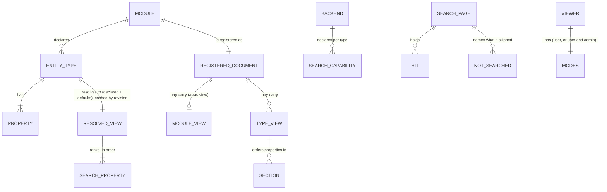

---
ddx:
  id: SD-011
  type: solution-design
  activity: design
  status: draft
  owner: Erik LaBianca
  updated: 2026-10-11
  authoring:
    home: repo
  links:
    - id: FEAT-011
      kind: informed_by
    - id: ADR-022
      kind: informed_by
    - id: ADR-023
      kind: informed_by
    - id: ADR-024
      kind: informed_by
    - id: ADR-025
      kind: informed_by
    - id: ADR-030
      kind: informed_by
    - id: ADR-021
      kind: informed_by
    - id: CONTRACT-010
      kind: informed_by
    - id: CONTRACT-006
      kind: informed_by
    - id: DESIGN-GB
      kind: informed_by
---

# Solution Design

**Feature**: [[FEAT-011]] | **Artifact**: `docs/helix/02-design/solution-designs/SD-011-graph-browser.md`

## Scope

- Feature-level design for the Graph Browser and the Explore/Operate shell: the library's `view` and `search` modules and the modes surface, the console schema additions, and the `arras-ui` browser entry and shell.
- Governing artifacts: ADR-022 (view vocabulary), ADR-023 (search), ADR-024 (location), ADR-025 (modes), ADR-021 (the package), CONTRACT-010 (exact surface), CONTRACT-006 and CONTRACT-009 (existing surfaces), the Module Boundaries of `architecture.md`, `concerns.md`; the visual design is `graph-browser-visual-design.md` (DESIGN-GB).
- Not covered: story-level files and tests (TDs, written when a slice is scheduled); exact shared surface (CONTRACT-010).
- **Timing.** The code-complexity rules (Biome with a cognitive-complexity ceiling of 15 and no suppression comments; a module-length ceiling) apply to this work. Every function and module in this design is shaped to those ceilings: many small functions, hooks and `*Parts` files, no module near the length ceiling.

## Requirements Mapping

### Functional Requirements

| Requirement | Technical Capability | Component | Slice |
|------------|---------------------|-----------|-------|
| FR-55 (BRW-05 to 08, 18) | Resolved view with defaults on the meta schema; a node page rendered from it | `view` (domain), `gqlschema`; browser `NodePage` | 1a, 1b |
| FR-56 (BRW-09 to 11) | Relationship groups from `Ref` keys and chunked label reads | browser `Relations`, `useNode` | 1b |
| FR-57 (BRW-12 to 14) | A grouped neighbourhood layout as a pure function, an SVG picture and its list equivalent | browser `Picture`, `layoutGroups` | 1b |
| FR-54 (BRW-04, 20) | The type list through the existing list read | browser `Entry` | 1b |
| FR-59 (BRW-20 to 23) | Fragment router with a host override; a client whose writes are declared actions invoked as the viewer | browser `location`, `api` | 1b |
| FR-60 (BRW-24 to 26) | `authorize_operator`, `GET /viewer`, the `not_operator` refusal; the shell and its switch | `operate`; browser `ArrasApp` | 1a, 1b |
| FR-58 (BRW-15 to 17, 19) | Parse and check `arras.view` at registration; resolve from the registered document | `view`, `umf`, `core` | 2 |
| FR-53, FR-54 (BRW-01 to 03) | A structured text match (`TextMatch`) beside the `query` statement; backend capability; ranking; the search UI | `searchplan`, `search`, backends, `gqlschema`; browser `Results` | 3 |

### NFR Impact on Architecture

| NFR | Requirement | Architectural Impact | Design Decision |
|-----|------------|---------------------|-----------------|
| Cost | Inside 50 selections, depth 6, 1,000 entities, 100 targets (CONTRACT-006) | A node page cannot be one query | A request planner in `useNode`: the page request reads properties, attribution, freshness and relationship keys only; labels come in chunked requests of at most 20 targets and 50 selections (see Node page requests) |
| Performance | Search and a node page ≤ 1 s p95 on the demo catalog | Few requests, small ones | Label chunks run in parallel; the view is cached per registry revision; the previous answer stays on screen while a new one loads |
| Security | No key or text in a URL path or query; the view is data; non-operators cannot reach the operate surface | Fragment router; closed vocabulary; text rendered as text; server-side refusal | React text nodes only (Biome's `noDangerouslySetInnerHtml` is on); the `link` format parses the URL, checks the scheme, adds `rel="noopener noreferrer"`; `authorize_operator` enforced in `operate` |
| Accessibility | WCAG 2.1 AA; keyboard; non-colour meaning | The relationship list is the accessible equivalent of the picture | Specified in DESIGN-GB; axe in the Playwright suite |
| Code shape | Complexity ≤ 15; module length ceiling | Small units | Layout, formatting, planning and ranking are separate pure modules with vector tests |

## Solution Approaches

### Approach 1: Server-resolved view, structured search match, thin browser

**Description**: Arras reads the registered document, resolves the view and serves it on the meta schema; search is a structured text match carried beside an ordinary `query` statement, a capability per backend, composed and ranked in the library; the browser renders what it is given.
**Pros**: One default for every client; the declaration is checked where it is registered; the statement is untouched (the match is never SQL); the backends persist nothing new.
**Cons**: Library changes in several places before search shows anything; no real backend serves search yet (ADR-023).
**Evaluation**: Selected.

### Approach 2: Browser-resolved view, search composed in the browser through the list filter

**Description**: The server returns the raw declaration; the browser derives defaults and filters by property.
**Pros**: No library change.
**Cons**: The list filter is equality on required scalar columns only (`queries.py`), so search cannot be built; defaults diverge per client; a bad declaration is found at render time.
**Evaluation**: Rejected.

### Approach 3: A separate service with its own index

**Description**: A service ingests entities and serves pages and search.
**Pros**: Fast, ranked, typo tolerant.
**Cons**: State of its own and a second access model (ADR-013, ADR-023).
**Evaluation**: Rejected.

**Selected Approach**: Approach 1, in four slices (FEAT-011): 1a a small server step, 1b the interface, 2 the declared view, 3 search.

**Architecture/ADR impact**: ADR-022 to ADR-025 are the new decisions. `architecture.md` has Module Boundaries rows (below). CONTRACT-001 has `Ontology.search` and the keyword-only `text` on `query`; CONTRACT-004 has the `search` and `searchable` capability and the conformance cases; CONTRACT-009 has `/viewer` and the refusal; CONTRACT-006 carries the meta fields and `_search`. Those edits land with the slice that implements them.

## Domain Model

### Business Rules

1. A view never changes a type: it is read from the document and is in no backend's catalog, so the registry's types are equal with and without a view by construction.
2. A view reads nothing the viewer's read did not return; a template over an omitted property drops that placeholder.
3. A type is searched only when it has a searchable property and its serving backend declares `substring`; every other requested type is named in `notSearched`, never counted as empty.
4. A hit is what the viewer may read; an unreadable entity is indistinguishable from an absent one everywhere (page, link, picture, count). A target that fails for cost is neither: it is a retry.
5. The location carries the node and nothing else; view state lives in the history entry's state.
6. Operate is an offer, not a permission: it is absent for a non-operator and the operate surface refuses a non-operator, but reading and changing remain what the backends allow.

## System Decomposition

### Library (Python)

| Module | Group | Responsibility | Public API |
|--------|-------|----------------|------------|
| `view` | domain | The vocabulary: closed sets, types for the declared and resolved view, template parser and evaluator, checks that emit `Violation`s with document paths, default derivation, size bounds | `parse_view(root, module) -> (declared, violations)`, `resolve(module, declared) -> ResolvedModule`, `evaluate(template, row) -> str`, `title_of(view, row, key)` |
| `viewcache` | domain | The resolved view kept by module and revision | `ViewCache.resolve(module, fetch)` |
| `searchplan` | domain | Text fold, word split, `TextMatch`, ranking, excerpt segments, the search result dataclasses | `fold`, `plan`, `rank`, `excerpt`, `SearchPage`, `SearchHit` and friends |
| `search` | core | `run_search`: choose searchable types, run the per-type reads (`Ontology.query` with a `text` match) under one revision, collect freshness, turn per-type failures into `notSearched` | `Ontology.search` |
| `fakes_search` | doubles | The in-memory substring match and its `Capabilities` | used by `fakes` |
| `operate` (existing) | operate | `authorize_operator`, `GET /viewer`, the `not_operator` refusal | `create_app(..., authorize_operator=None)` |
| `umf`, `model`, `backend`, `gqlschema`, `core`, `console` (existing) | | `umf` accepts the vocabulary and calls `view.parse_view` for its checks; `model.Capabilities` has `search` and `searchable`; `Backend.query` takes the `TextMatch` beside the statement, and the backend checks a text match against its `search` capability and `searchable` properties; `gqlschema` serves the meta fields and `_search`; `core` resolves and caches the view per module and revision and exposes `Ontology.search` as a thin delegate (decided: the search composition lives in the interface so the console and a later MCP tool share it; CONTRACT-001 carries it) | |

Boundary changes to `tests/modules_check.py` and `architecture.md`: `view` and `searchplan` are in the domain group (allowed: foundation, domain), `search` and `fakes_search` take the core and doubles groups, the search result types live in `searchplan` so that `gqlschema` (schema group) never imports `core` at run time. `fakes.py` (850 lines) and `core.py` (822) are near the module-length ceiling, so the matching code is in `fakes_search` and `Ontology.search` is a one-line delegate. A search never takes a lock the console's pool holds: it runs its reads one after another.

### Interface (TypeScript, `arras-ui`)

| Module | Responsibility |
|--------|----------------|
| `src/shell/` | `ArrasApp`: asks `/viewer`, renders Explore or Operate, the mode switch, the hash grammar (`#/explore/…`, `#/operate/…`, and a fragment with no prefix, read as Operate for an operator) and the carry-over of module, type and entity between the modes, the standalone host's entry |
| `src/browser/` (entry `arras-ui/browser`) | `GraphBrowser`; `Entry`, `Results` (slice 3), `NodePage`, `Relations`, `Picture`; `useNode`, `useView`; the search read (`searchEntities`, `useSearch`) is `api/search.ts`, shared with the console palette; `location` (router and host override); `format` (templates, formats, tones); `icons` (the 24 drawings); `layoutGroups` (the picture layout, pure) |
| `src/kit/` (SD-013; internal) | The action kit both modes import and that imports neither: the plan derivations (`editPlan`, `linkPlan`, `retirePlan`, `createPlan`, `entityActions`, the claims rule, `changedIds`), pure and tested once; imports `api/`, `lib/inputs`, `lib/format`, `lib/formFocus`, `lib/template` only, and nothing in `lib/` imports it |
| `src/api/` (existing) | client and queries; carries the view, `_search` and `/viewer` queries |
| `src/areas/`, `src/console/`, `ArrasConsole.tsx` (existing) | unchanged; Operate mounts `ArrasConsole` (`console/` holds its shell, header, tabs, route and view state) |

Boundary rules: `browser/` imports `api/`, `components/ui`, `ds/` (the design-system seam, ADR-029), `kit/` (the action kit of SD-013 and [ADR-030](../adr/ADR-030-the-action-kit-and-its-import-rule.md): the plan derivations, the form model and the write core), `lib/relLabels` (the one label planner `browser/planner.ts` calls), `lib/format`, `lib/inputs` (the shared input codec, for in-place edits), `lib/download` (saving the exported graph), `lib/template` (the title template), `lib/brand` (the name and wordmark) and `lib/documentTitle` (the document title) and its own modules, never `areas/`; `areas/` and `ArrasConsole` never import `browser/` or `shell/`; `shell/` imports both. A Biome `overrides` entry for `src/browser/**` restricts imports (`noRestrictedImports`), and a Vitest in the style of `src/test/code-shape.test.ts` fails on a forbidden edge and on `dangerouslySetInnerHTML`. `package.json` exports include `"./browser": "./src/browser/index.ts"` and `"./shell"`; `src/index.ts` (the console) does not export the browser. The standalone host (`ui/index.html`, `main.tsx`) mounts `ArrasApp`.

### Node page requests (the planner)

One query cannot hold a page, its neighbours' labels and a picture inside CONTRACT-006's 50-selection and 100-target limits. `useNode` therefore plans:

1. **Page request** (one): the entity's declared properties, `key`, `type`, `version`, attribution, `freshness`, and for each relationship field `[Ref { module type key }]` (no `target`). About 20 own fields and 4 per relationship field stay inside 50 for the catalog's types; a type with more is split across two page requests by the planner (properties first, relationships second).
2. **Label requests** (several, in parallel): for the first 20 refs of each group and the picture's nodes (at most 40 in all), requests of at most 20 targets and 50 selections, one aliased by-key read per target (`t0: solution(key: $k0) { <title properties> }`) on the target's own module endpoint (`Ref.target` of another module returns no properties, and a by-key read needs no `target` budget). Only the title's properties are selected, so a target costs one selection per placeholder plus its by-key field and a request holds `floor(50 / (1 + placeholders))` targets, at most 20. Title properties come from the resolved view's `title` template placeholders.
3. A **cost refusal** or error on a target (`COST_EXCEEDED`, a failed endpoint) yields a retry state for that neighbour; a null `target` without an error is "Not available".
4. **Show more** labels the next 20 of the keys already read; beyond 100 keys it reads one page (at most 100) of the other type's list filtered by the inverse relationship when there is an inverse, marked when it is truncated, else the group says "first 100". It loads no further page.
5. The view for the module is read once per registry revision (`useBrowserMeta`, a call of the shared `useMeta` under the key `["meta"]`), as the one meta read both modes make: the registry with the module's view and actions, then each type's resolved view. CONTRACT-006 caps a request at 50 field selections, so the meta read is two requests merged by the client, which reads them again once if the revisions differ.

## Layout of the picture (`layoutGroups`)

A pure function from `{centre, groups}` to `{nodes, edges, captions, size}`; the same input always gives the same output.

- **Order**: groups by the relationship view's `order`, then label; members of a group by title (case-folded), then key.
- **Cap**: 40 nodes in all, taken round-robin one member per group in order until the cap, so every group is represented (the planner chooses the 40 from the keys in the order the server returned them, and the layout orders the chosen members by title within each group, since a relationship returns keys, not titles); a group's left-out count is its caption's suffix (`ADDRESSES · +3 more`) and is not a node.
- **Big groups**: a group with more than 8 drawn members is not a column but a block of rows of three 134 px pills in the top or bottom band, so a hub does not make a picture as tall as the card.
- **Sides**: group 0 is a column on the left, group 1 a column on the right, group 2 a row along the bottom, group 3 a row along the top; group *n* ≥ 4 goes on side *n* mod 4 after the groups already there (a column continues downward, a row continues rightward and wraps to a new row beneath it).
- **Geometry**: the constants of DESIGN-GB (centre 120 × 48; left nodes 134 wide, right 120, rows 150; pills 36 high; 12 px gutters; 440 px wide canvas, height from the rows).
- **Edges**: a cubic curve from the centre's nearest edge to the neighbour's edge; a self-link is a loop on the centre; an entity in two groups is drawn in its first.
- **Vectors**: golden coordinates for 0, 1, 7, 40 and 120 neighbours and for three, five and six groups are test vectors (`ui/src/test/layout.vectors.json`), so a change to the layout is a reviewed diff.

## Modes and location

- The shell reads `/viewer` once; until it answers or if it fails it renders Explore with no switch (never assumes operator).
- Hash grammar: `#/explore/<module>/<type>/<key>` (Explore), `#/operate/<module>/<area>[/<type>[/<key>] | /<action>]` (Operate; CONTRACT-010 D), no prefix = read as Operate for an operator and as the Explore entry for anyone else. The browser and console each own their part; they cannot collide because the first segment is fixed.
- Operators are the members of the host's operator groups (by default `admins` and `builders`); the dev host gives root `admins`, alice and bob `builders`, and carol and dave no group, and passes `operators_in_groups("admins", "builders")` as `authorize_operator`.

## Technology Rationale

| Layer | Choice | Why | Alternatives Rejected |
|-------|--------|-----|----------------------|
| Picture | Hand-written SVG and a pure layout function | ≤ 40 nodes, accessible, themable by tokens, golden-vector testable; the repo already draws its module graph with its own layout | A graph library: bundle size, physics layouts, accessibility |
| Icons | 24 inline SVG paths in `browser/icons` | A closed set, no dependency | An icon library |
| Router | A small fragment router | One route shape; a host can replace it | A router library |
| Search state | TanStack Query keyed by the text, abort on change | Already the stack | A bespoke store |

## Verification Plan

Tiers, each mapped to the stories (traceability below):

1. **Python unit and property tests**: `view` (checks, templates, defaults, sizes), `searchplan` (fold, rank, excerpts, literal `%`/`_`/`\`), the property test that types are equal with and without a view, `authorize_operator` and the viewer endpoint, `tests/modules_check.py` with the new modules and negative controls. Backend **conformance corpus** cases for the search capability (escaped text, folded match, unsupported type, unavailable backend) run against the fakes.
2. **UI unit tests (Vitest)**: `format`, `layoutGroups` golden vectors, `location`, `useNode` planner (chunks, cost refusal as retry, "Not available" as null), components with the fetch double.
3. **UI integration tests** against the real dev host (existing tier).
4. **Whole-stack Playwright e2e** (`ui/e2e/browser.spec.ts`, a project beside the existing ones) against the dev host: the primary reader workflow (type or choose a type, open a node, follow a link, use the picture), the mode switch as alice and carol, the server refusal as carol, the not-available cases as dave, the request recorder (no key or text in a path, query or `Referer`; no write), keyboard-only paths, and `axe` on every screen in light and dark.
5. **Visual review by screenshot**: a Playwright test renders each screen of DESIGN-GB at 1280 × 900 and 390 × 844 in light and dark from the running app, stores the PNGs as artifacts, and compares them with reviewed baselines (0.5% pixel threshold); each slice ends with a human review of the screenshots against the mockup, differences either fixed or recorded in DESIGN-GB.

**Fixtures.** The dev host's demo catalog (12 use cases, 10 solutions, coverage and findings through declared actions) is the default dataset. The tests create what the demo lacks through the operate surface as alice: a hub (a use case addressed by 25, and by 120, solutions, in batches of at most 100), long text, and a Solution with a launch URL. The dev host's control endpoint has `grant` and `revoke` for a person on a module and a `search` override per type and an `outage` already exists, so the cross-module and unavailable cases can be staged; a second module is registered through the existing `register` control.

## Traceability

| Requirement ID | Component | Design Element | Test Strategy |
|---------------|-----------|----------------|---------------|
| FR-55, BRW-05 to 08, 18 | `view`, `gqlschema`, `NodePage`, `format` | Resolved view; formats | Python: defaults vectors; UI: format and component tests; e2e; US-067 |
| FR-56, BRW-09 to 11 | `Relations`, `useNode` | Keys then chunked labels | UI: planner; e2e with the hub fixture; US-068 |
| FR-57, BRW-12 to 14 | `Picture`, `layoutGroups` | Grouped layout, cap, list equivalent | UI: golden vectors; e2e: axe, keyboard; screenshots; US-069 |
| FR-54, BRW-04, 20 | `Entry` | Type list through the list read | e2e; US-066 (AC1, AC2) |
| FR-59, BRW-20 to 23 | `location`, client | Fragment router; a client whose writes are declared actions invoked as the viewer | e2e recorder; US-071 |
| FR-60, BRW-24 to 26 | `operate`, `ArrasApp` | Hook, `/viewer`, refusal, switch | Python: operate tests; e2e as alice and carol; US-072 |
| FR-58, BRW-15 to 17, 19 | `view`, `umf`, `core` | Closed vocabulary and checks; resolution from the document | Python: checks and conformance; US-070 |
| FR-53, FR-54, BRW-01 to 03 | `searchplan`, `search`, `fakes_search`, `Results` | Structured match, capability, rank | Python: vectors and conformance; e2e on the in-memory backend; US-065, US-066 (AC3 to AC6) |

### Gaps
- [ ] No real backend serves search (ADR-023, PRD open question); slice 3 ships working on the in-memory backend and "not searched" elsewhere.
- [ ] The Operator Console's whole-module graph and the picture both draw nodes; a shared glyph component would couple `browser/` to `areas/`, so it moves to `components/` with slice 1b, a move and not a copy.

## Concern Alignment

- **Concerns used**: modularity-and-encapsulation (Module Boundaries above), `typescript-biome` and `code-shape-ceilings` (complexity 15, module length), the UI accessibility and end-to-end practices as FEAT-010 applies them, `o11y-otel` (search text kept out of telemetry per ADR-018 and CONTRACT-008), ADR-005 (nothing here widens what is read).
- **Constraints honored**: no state of Arras's own (ADR-013); the viewer's own token on every read (ADR-017); no write path (ADR-015); the UI reaches Arras over HTTP only (ADR-021).
- **ADRs referenced**: ADR-022 to ADR-025, ADR-021, ADR-013, ADR-014, ADR-017.
- **Departures**: ADR-024 scopes an exception to FEAT-010's no-key-in-a-URL rule for the browser only and is itself the justification.

## Constraints & Assumptions

- **Constraints**: CONTRACT-006's limits bound every request; search adds nothing to the query language; Biome's ceilings apply to every new function and module.
- **Assumptions**: the in-memory backend is enough to build and test search; the demo catalog plus created fixtures is enough for the e2e suite.
- **Dependencies**: `graphql-core`, React, TanStack Query, Tailwind, Playwright and `@axe-core/playwright` (all existing); no new dependency.

## Risks

| Risk | Prob | Impact | Mitigation |
|------|------|--------|------------|
| The picture is visually busy at 40 nodes | M | M | The cap, group captions, label rules and a list equivalent (DESIGN-GB); screenshot review at 0, 7, 40 and 120 neighbours |
| A node page makes too many requests for a hub | M | L | 20 labels per group first, chunks of 20 targets, parallel; measured in e2e |
| Closed sets prove too small for the first real module | M | M | A vocabulary minor version per addition; extend from evidence |
| A host forgets `authorize_operator` | M | M | The default is stated in the embedding guide and logged at start; the standalone and dev hosts pass it |
| Search ranking is surprising | M | L | The tiers are in the contract and the vectors pin them |
