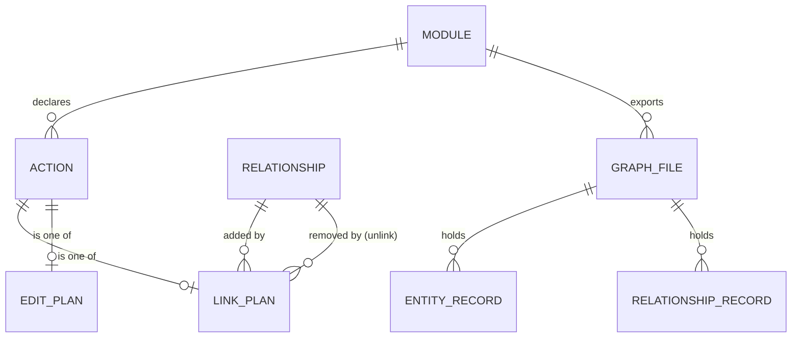
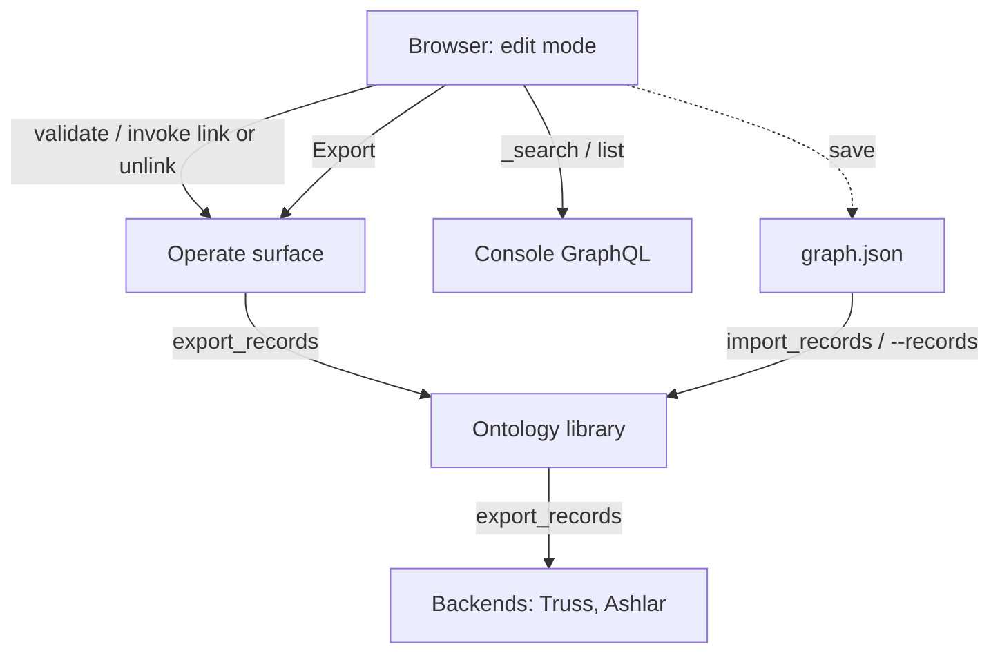

---
ddx:
  id: SD-012
  type: solution-design
  activity: design
  status: draft
  owner: Erik LaBianca
  updated: 2026-10-12
  authoring:
    home: repo
  links:
    - id: FEAT-011
      kind: informed_by
    - id: SD-011
      kind: informed_by
    - id: ADR-015
      kind: informed_by
    - id: ADR-028
      kind: informs
    - id: CONTRACT-001
      kind: informed_by
    - id: CONTRACT-003
      kind: informed_by
    - id: CONTRACT-004
      kind: informed_by
    - id: CONTRACT-006
      kind: informed_by
    - id: CONTRACT-009
      kind: informed_by
    - id: CONTRACT-010
      kind: informed_by
---

# Solution Design

**Feature**: [[FEAT-011]] | **Artifact**: `docs/helix/02-design/solution-designs/SD-012-graph-browser-editing-and-export.md`

## Scope

- Feature-level design for two additions to the Graph Browser (SD-011): editing a node's relationships in place, and exporting the graph so what was changed in the browser can be kept and loaded again.
- In-place editing of properties already exists (CONTRACT-010 F) and is the pattern this design extends: the browser reads the module's declared actions and offers an edit only where one fits, and a change is that action validated and invoked as the viewer.
- Creating and retiring whole records from the browser are in scope through SD-013 (a `createPlan` and a `retirePlan` beside the plans here).
- Out of scope: a merge of an exported file with a live graph, and any change to how a module declares actions (UMF's).
- Governing artifacts: ADR-015 (actions are the only write path), CONTRACT-001, 003, 004, 006, 009, 010, PRD FR-59, FR-64 to FR-66.

**The loop this serves (confirmed).** Load a graph, edit it in the browser, save, export, commit the file, and load it again. Git is the graph's persistence until a database holds it, and the exported files ship as known-good fixtures; the database takes over the same records later (ADR-028). The dev host's data is in memory, so without an export every browser edit is lost on restart.

## Requirements Mapping

### Functional Requirements

| Requirement | Technical Capability | Component | Priority |
|------------|---------------------|-----------|----------|
| FR-65: where the host offers edits, a relationship group offers adding and removing a link when the module declares an action that does it | Link plans derived from declared `link` and `unlink` actions; an add picker and a remove control in edit mode | `linkPlan` and the group controls (`arras-ui`) | P2 |
| FR-66: an operator can export a module's graph as records that load back unchanged | An export read that yields entity and relationship records in the shape `import_records` takes, written as a canonical file; a download in the browser; a load path in the dev host | `export_records` and `graphfile` (library), `POST /export` (operate), Export control (`arras-ui`), `--records` (dev host) | P2 |
| FR-64 (existing): property edits | Unchanged | | P2 |

### NFR Impact on Architecture

| NFR | Requirement | Architectural Impact | Design Decision |
|-----|------------|---------------------|-----------------|
| Security | Every write is the viewer's, by a declared action; no new write path (ADR-015) | Relationship edits reuse `validate` and `invoke`; export is a read | Neither feature adds a write. Export runs as the viewer and shows only what the viewer may read |
| Security | A file leaving the system carries no more than the viewer may read | A partial export must say it is partial | The export header states whether every type and relationship was readable (below) |
| Performance | A request resolves at most 1,000 entities and a relationship field returns at most 100 keys (CONTRACT-006) | A whole-graph export cannot be a GraphQL list read | Export is paged by the library, not composed in the browser |
| Fidelity | A reload reproduces the graph | The format must carry every property and every link | Records of CONTRACT-003 Import; original author and time only where a record already has them, so an export never invents a provenance |
| Reviewability | A file in git shows only what changed in the graph | The same graph must be the same bytes | A canonical file: stable order, sorted keys, no time, person or revision (ADR-028) |

## Solution Approaches

### Part 1: relationship editing

### Approach 1.1: Derive link plans from declared link and unlink actions, as property edits do
**Description**: A relationship can be added to when the module declares an action with one `link` effect of that relationship whose source and target are the action's two `ref` inputs (and whose other inputs, if any, are optional). It can be removed from by the same shape with `unlink`. In edit mode each relationship group offers Add where a link plan exists and a remove control on each member where an unlink plan exists. Add opens a popup with a picker over the other end's type; remove asks once.
**Pros**: No new server surface; follows the module's own actions, so a module that does not want a link editable declares no action; the catalog already has them (`AddressUseCase`, `UnaddressUseCase`, `ClearSolutionProvider` and others).
**Cons**: The browser cannot know ahead whether the viewer may invoke the action (as for properties); a to-one relationship is refused by `validate` after the viewer picks, not prevented.
**Evaluation**: Selected.

### Approach 1.2: A generic "edit relationships" action declared by UMF
**Description**: UMF defines a standard link action the browser calls by name.
**Pros**: One shape to find.
**Cons**: Needs UMF to define it (not Arras's to decide); a module could not restrict which relationships are editable; ignores the actions modules already declare.
**Evaluation**: Rejected.

### Part 2: graph export

### Approach 2.1: Export as the records `import_records` takes, read by the library
**Description**: A library read, `export_records(module)`, yields entity records (`type`, `key`, `properties`, `original_author`, `original_at`) then relationship records (`relationship`, `source`, `target`, `properties`, ...), paged by the library from the backends, as the viewer. It is exposed to operators as `POST /export` (paged by cursor) and as an Export control that saves `<module>.graph.json`. The file loads back through `import_records` and, for the dev host, `--records <file>`.
**Pros**: Round-trips by construction (import is idempotent, applies entities before relationships, skips what exists); carries every property and every link with no 100-key cap; deterministic, so git diffs are meaningful; backend-neutral; the same file moves a graph between a dev host and Truss and is what a database loads once git stops being the store.
**Cons**: A new operation (ADR-028 and changes to CONTRACT-001, 003, 004 and 009); import is administrative, so loading into Truss stays an admin act; a reload does not replay history (the journal starts again) and created-by and updated-by are not in the file (git records who changed the file).
**Evaluation**: Selected.

### Approach 2.2: Export the actions that produced the graph, as `seed.json` steps
**Description**: Emit `{action, inputs}` steps, the dev host's seed format.
**Pros**: Matches the seed file's format; human readable.
**Cons**: The journal records effect-level ops, not action inputs, so the inputs cannot be recovered; deriving steps from the graph means choosing a create action per type and a link action per relationship, which a module may not declare or may declare in combinations (`AddSolution` creates and links). Fragile and module-specific.
**Evaluation**: Rejected for the export. `seed.json` remains the way to author a graph from scratch.

### Approach 2.3: Compose the export in the browser from list reads
**Description**: The browser pages each type with `<t>List` and reads relationship keys.
**Pros**: No server work.
**Cons**: A relationship field returns at most 100 keys, so a hub's links are silently dropped; each page is a request under the 1,000-entity budget; the browser would assemble a file whose completeness it cannot vouch for.
**Evaluation**: Rejected.

### Approach 2.4: Log the browser's own invocations and export the log
**Description**: Record each `invoke` the browser makes and export those as steps to append to `seed.json`.
**Pros**: Cheap; exactly the edits made.
**Cons**: Covers only this session's browser edits, not changes made elsewhere; not a graph export; the log lives in the page.
**Evaluation**: Rejected as the export; noted as a possible later convenience.

**Selected Approach**: 1.1 and 2.1. Relationship edits stay a browser-only change over existing surfaces and can ship first. Export is a library read mirrored on `import_records`, so a file the UI produces is a file the library accepts.

**Architecture/ADR impact**: Part 1 none (CONTRACT-010 F is extended). Part 2 is ADR-028 (the export operation, the file and its rules) with additions to CONTRACT-001, 003, 004, 009 and 010; the module map has `graphfile` and `fakes_export`.

## Domain Model

### Business Rules
1. **A link plan** exists for a relationship when the module declares an action with exactly one effect, `link` (to add) or `unlink` (to remove), whose `type` is the relationship, whose source and target are `{name}` expressions for two `ref` inputs of cardinality one typed as the relationship's source and target, and whose other inputs are all optional. Anything else gives no control.
2. **Direction follows the group.** On a page the group for the relationship's own name is the page's entity as source; the group for its inverse name is the page's entity as target. The page's key fills the matching input and the picked entity fills the other. A relationship from a type to itself is told apart by the group's direction.
3. **Where several actions qualify**, they are ranked by SD-013 Rule 1a, as for properties.
4. **Add** offers a picker over the other end's type (the type's list at once, narrowed locally as the reader types; when the list is cut short (`truncated`) and the module serves search, the `_search` read restricted to that type), shows what is already linked as already chosen, and sends one `validate` then `invoke` with the two keys. A refusal (a to-one relationship already full, a missing endpoint) is shown as the action gives it.
5. **Remove** asks once ("Remove the link to X?"), then `validate` and `invoke`.
6. **Links that make a record what it is** (the catalog's `ofProduct`, `ofUseCase`, `versionOf`, `about`) have no action, so no control: to point one elsewhere the record is retired and added again.
7. **An export** holds every entity of every type the viewer may read, then every relationship instance between entities in the file, each once, in a stable order (types in declaration order, by key; relationships by name, source, target). The file names the format, version and module and says `complete: false`, with `omitted`, when a type was unreadable or a backend unavailable; it holds no time, person or revision, so the same graph is the same bytes. A load never replaces, so a partial file cannot overwrite a graph.
8. **A load never replaces.** `import_records` creates what is missing and skips what exists; changing an existing entity from a file is out of scope, so iterating means editing in the browser, exporting, and loading into a fresh graph.

## System Decomposition

### Component: Link plans and group controls (`arras-ui`, `kit/` and `browser/`)
- **Purpose**: Offer adding and removing a link where the module declares how.
- **Responsibilities**: the plan derivations (`linkPlan`, `editPlan`), which live in `ui/src/kit/` (SD-013 D1) as pure functions tested against the catalog, with the rules above; an Add control and a popup picker; a remove control with its confirmation; the shared validate and invoke hook (`useEdit`, over the inputs of one action); invalidation after a change.
- **Requirements Addressed**: FR-65.
- **Interfaces**: Reads the module's `actions` the browser already requests when `canEdit` is set; `_search` and list reads (CONTRACT-006, CONTRACT-010 C); `validate` and `invoke` (CONTRACT-009). CONTRACT-010 F is extended with the plan rules and the controls.
- **Built**: `kit/linkPlan.ts` (`groupLinks`) and `kit/editPlan.ts` (the plan derivations of SD-013 D1, pure functions tested against the catalog), `useAction.ts` (the shared validate and invoke that `useEdit` and the link controls use), `LinkControls.tsx` and `LinkDialog.tsx`, and the group controls in `Relations.tsx`. The picker lists the type first and searches when the list is cut short (`usePick.ts`).

### Component: Export read (library)
- **Purpose**: Produce the graph's records as the viewer, and write and read the graph file.
- **Responsibilities**: `Ontology.export_records(module, *, limit, after)` paging entity records then relationship records through a new backend operation; `arras.graphfile` (`export`, `dumps`, `loads`), the canonical file; marking an incomplete export; never reading what the viewer may not.
- **Requirements Addressed**: FR-66.
- **Interfaces**: A backend operation `export_records(principal, module, after, limit)` (CONTRACT-004; a reader that cannot serve it answers `Unsupported`, and the type is named in the header); the record shapes are CONTRACT-003 Import's.
- **Owned by TDs**: TD for the backend operation on the Truss adapter and the fakes; TD for the conformance corpus cases.

### Component: Operate export endpoint and Export control
- **Purpose**: Offer the export to operators in the interface.
- **Responsibilities**: `POST /export` on the operate surface (operator-gated like the rest, a `POST` so the module and cursor are never in a URL) returning a page of records with a cursor; the browser pages it and saves one file; an **Export graph** control on the module's entry page only, offered where the host offers edits (`canEdit`) and needing no edit mode, which is the interface's only graph export control; Operate has none (SD-013 D7).
- **Requirements Addressed**: FR-66.
- **Interfaces**: CONTRACT-009 has `POST /export`; `arras-ui` has `client.export`.
- **Owned by TDs**: TD for paging and saving a large file without holding it all in memory.

### Component: Dev host load (`arras.devhost`, `arras.sandbox`)
- **Purpose**: Close the loop in the dev host.
- **Responsibilities**: `--records <file>` loads a graph file through `import_records` after the module is registered and any `--seed` steps have run; a clear error for a file for another module or one the graph rejects.
- **Requirements Addressed**: FR-66.
- **Owned by TDs**: TD for the flag and the sandbox's administrative principal.

### Component Interactions

## Technology Rationale

| Layer | Choice | Why | Alternatives Rejected |
|-------|--------|-----|----------------------|
| Export format | CONTRACT-003 Import records as canonical JSON | A loadable round trip with no new schema; byte-stable for git; idempotent on reload | Seed action steps (not derivable); a UMF-defined data format (UMF does not define one) |
| Export transport | A paged `POST` read on the operate surface | Keeps the viewer's token, the operator gate and the no-key-in-URL rule; bounds memory | A GraphQL list read composed in the browser (100-key cap); a streaming download endpoint (a second auth path) |
| Picker | The type's list, then `_search` when the list is cut short | Already principal-scoped and bounded (CONTRACT-010 C) | A new "candidates" read |

## Traceability

| Requirement ID | Component | Design Element | Test Strategy |
|---------------|-----------|----------------|---------------|
| FR-65 | Link plans and group controls | Business rules 1 to 6 | Unit tests of `linkPlan` against the catalog and the browser fake; component tests for add, remove, refusal and edit-mode gating; a live check on the dev host; the catalog test that every relationship a record can lose has an action |
| FR-66 | Export read, endpoint, control, dev host load | Business rules 7 and 8 | Conformance cases for the backend operation; a library test that export then import into a fresh sandbox reproduces every entity and link; an operate contract test (operator only, paged, `POST`); a browser test that Export saves a file of the expected shape; a dev host test for `--records` |

### Gaps
- [ ] An export is only as complete as the viewer's reads. Mitigation: `complete` and its reasons in the header, and no replace load.
- [ ] Whether every backend can list relationship instances without the 100-key cap is unconfirmed for Truss and Ashlar. Mitigation: CONTRACT-004 defines the operation; a backend that cannot serve it answers `Unsupported` and the file says which types were left out.
- [ ] Loading a file into a Truss module is an administrative act (CONTRACT-005) and is not offered in the browser.
- [ ] Only the in-memory backend implements `export_records`; the conformance corpus (CONTRACT-004, version 13) holds any adapter to it, so a real backend's adapter must pass those cases before it ships.
- [ ] A to-one relationship that is already full is refused by `validate` after the viewer has chosen, not prevented; the browser has no read of a relationship's multiplicity at the instance level (it shows the action's reason).

## Concern Alignment

- **Concerns used**: `admin-console` (operator-facing changes only through declared actions), `frontend-framework` (React with TypeScript, TanStack Query, in `ui/`), the Python 3.11 library with `uv`.
- **Constraints honored**: Writes are UMF actions applied on the authoritative backend (ADR-015); access is the backends' own; Arras keeps no role model (the host's `authorize_operator` decides who is offered edits and export); Truss, Ashlar and UMF documents never name Arras.
- **ADRs referenced**: ADR-015, ADR-021, ADR-025; ADR-028 records the export operation.
- **Departures**: None.

## Constraints & Assumptions

- **Constraints**: A request resolves at most 1,000 entities and 50 field selections; a relationship field returns at most 100 keys (CONTRACT-006). Import is administrative and library-only (CONTRACT-003).
- **Assumptions**: (1) The loop in Scope is the intended use; if the aim is a production backup or a hand-off to another system, the same format serves but the load path changes. (2) Operators, as the host defines them, may export; no separate export grant. (3) An exported file may name entities the next reader may not see; that is the operator's file to protect, as the schema export is.
- **Dependencies**: `import_records` (CONTRACT-003); the sandbox's administrative principal; the backends' ability to enumerate relationship instances.

## Risks

| Risk | Prob | Impact | Mitigation |
|------|------|--------|------------|
| A file is partial and mistaken for the whole graph | M | H | Header `complete`, reasons, and no replace load |
| A backend cannot enumerate relationship instances | M | M | `Unsupported` per type, named in the header; conformance case |
| An add control offered for a relationship the viewer may not change | H | L | Refusal shown at the picker; same limit as property edits (no "may invoke" read exists) |
| A to-one relationship is filled and the add is refused after the viewer picked | M | L | Show the action's reason; consider a precondition hint in a later contract change |
| Export leaks data the operator should not hold | L | H | Viewer-scoped read, operator gate, `POST`, no key or text in a URL, telemetry carries no content (CONTRACT-008) |
