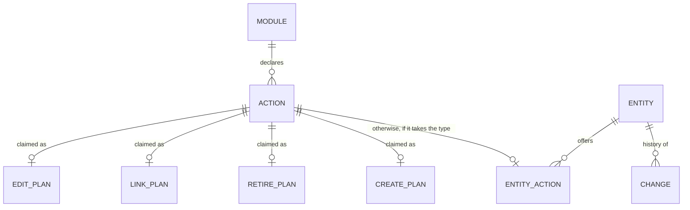
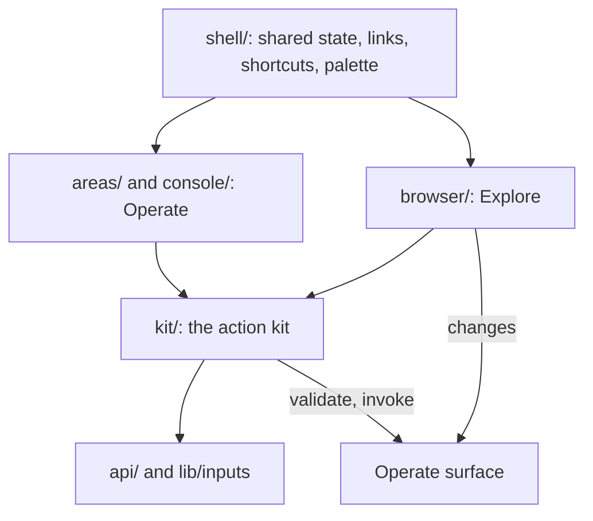

---
ddx:
  id: SD-013
  type: solution-design
  activity: design
  status: draft
  owner: Erik LaBianca
  updated: 2026-10-12
  authoring:
    home: repo
  links:
    - id: FEAT-010
      kind: informs
    - id: FEAT-011
      kind: informs
    - id: SD-011
      kind: informs
    - id: SD-012
      kind: informs
    - id: ADR-024
      kind: informs
    - id: ADR-025
      kind: informs
    - id: CONTRACT-010
      kind: informs
    - id: ADR-015
      kind: informed_by
    - id: ADR-027
      kind: informed_by
    - id: ADR-028
      kind: informed_by
    - id: ADR-029
      kind: informed_by
    - id: ADR-030
      kind: informed_by
    - id: CONTRACT-003
      kind: informed_by
    - id: CONTRACT-006
      kind: informed_by
    - id: CONTRACT-009
      kind: informed_by
---

# Solution Design: one interface, two modes

**Feature**: [[FEAT-011]] (with [[FEAT-010]]) | **Artifact**: `docs/helix/02-design/solution-designs/SD-013-instance-work-in-explore-and-the-shared-action-kit.md`

## Scope

- The unifying design of the interface. It fixes what each mode is for (the Graph Browser, **Explore**, works on instances; the Operator Console, **Operate**, works on the model and the platform), the layers both modes share, and how every design and every finished workstream fits into one whole. SD-011 (the browser), SD-012 (editing and export) and FEAT-010 (the console) keep their detail and are read through this document; each states the same design (see "How the other documents carry this design").
- In scope: creating an entity, retiring one, an entity's history, a menu of the other declared actions that apply to an entity, deep links between the modes, the shared layer under both (the **action kit** and the other shared pieces), state across a mode switch, and the vocabulary.
- Out of scope: batch invoke, schema registration and import, the Query area, the whole-module Changes area (they stay Operate); changing how a module declares actions (UMF's); migrating the console's remaining screens to the design-system widgets (ADR-029 work with its own order).
- Governing artifacts: ADR-015 (actions are the only write path), ADR-025 (two modes; Operate is the host's offer), ADR-027, ADR-028, ADR-029, SD-011, SD-012, CONTRACT-003, 006, 009, 010.

**The principle.** Explore works on instances: find, read, change, create, retire, see what happened. Operate works on what instances are made of and where they live: the model, the backends, the registry, bulk and import work, the changes of a whole module, and the query language. A task about one entity belongs in Explore; a task about the module as a system belongs in Operate; each links to the other where the task crosses.

**The three users.** The ordinary viewer (carol) has Explore only and reads: search, follow, the picture, an entity's attribution; no lock, no menus, no History, no cross-mode links; this is what most people see. The operator (alice, bob) has both modes and Explore's writes. The developer uses the dev host's sandbox roles to be either.

## Decisions

| # | Decision | Reason |
|---|----------|--------|
| D1 | The kit lives in `ui/src/kit/`, is internal (not an npm subpath), and is headless first with chrome-free pieces | `actions/` is also an area, a route segment and the substring a guard test refuses in `browser/`; hosts keep `ActionForm` |
| D2 | The kit's form model takes an injected `ModuleInfo`, an `onApplied(receipt)` callback and a `reloadModule()` callback, and returns a neutral `{effects, status, valid, receipt}`; the console adapts it to `ImpactState` in `areas/` | The console's hook reads the console meta, its cache keys and `ImpactState`; used as written, Explore would read meta twice and go stale after an apply |
| D3 | `RefPicker` stays in `browser/`; the kit defines a `RefInput` slot the console fills with a key field and Explore with the picker | The picker's list and search are built on the browser's views and `_search` |
| D4 | Retire and the Actions menu sit behind edit mode (the lock); **New** is a button on a type's list, offered only in edit mode (`NewEntity` shows it behind the lock, and only where the host offers edits and a declared action creates the type) | The lock is the one "I am changing things" switch; a control that changes data on every page for every operator is the wrong default |
| D5 | Operate's Entities, Graph and Actions areas are kept and frozen: no new per-entity feature is added to Operate; each new per-entity need is built in Explore and Operate links to it | Operate's per-entity surface stays as it is until the kit makes the duplicate flow one code with two chromes; trimming it follows |
| D6 | One `QueryClient`, one meta read, the single-key switch, the palette and the Query session live at the shell | Otherwise a mode switch discards the caches, the draft and the history, and two unrelated invalidation schemes remain |
| D7 | `Export graph` is Explore's only, on the module's entry page; the console has no graph export control (its Export is of UMF documents) | One home for instance export |
| D8 | Competing actions are ranked by one rule with no name heuristics (Rule 1a); there is no name-based tie-break (`kit/claims.ts`, `kit/entityActions.ts`) | Plans are derived from declarations, not names |
| D9 | Tabs and words follow the adopted vocabulary (below) | One vocabulary |
| D11 | The product name is configuration, not code: a `brand` (name, optional wordmark or logo, optional page title) given to the shell, the browser and the console; "Arras" is only its default | A host (an embedding application) must be able to present the interface under its own name |
| D12 | Every place the interface can be is an address, and the address is the whole identity of the page: mode, module, area, type, entity and the view state that selects what is shown; only text the contracts keep out of addresses (search text, query text, typed form values) is not in it | Pages must be bookmarkable and shareable, and Back and Forward must move through them |
| D10 | The five Explore features are built natively, in an order that retires risk first; deep-linking History and Actions to Operate instead (the smaller design) is the fallback if the kit proves costly | Operators should not leave Explore for an entity task |

## Requirements Mapping

### What each mode does with an entity

| Capability | Operate | Explore | Home |
|------------|---------|---------|------|
| Create an entity (`Add...` actions that create and link) | Actions area | New on a type's list, in edit mode | Explore |
| Retire or delete (`Retire...` actions) | Actions area | Retire on a node page, in edit mode | Explore |
| Any other declared action on an entity (several effects, record or list inputs) | Actions area with an effects preview on the graph | single-property edits and single link or unlink in place, with a pencil on each property in a section row, on a header badge, and on each property the title and summary templates place, beside its text (one per action where a form edits several at once; never the key); the Actions menu, in edit mode, with a text summary of the effects | Explore |
| An entity's history | Changes (`changes` by type and key) | the History panel, for operators | Explore |
| Batch invoke | Actions area | none | Operate |
| Query, whole-module Changes, import loads | Query and Changes areas | none | Operate |
| Model, backends, capabilities, UMF source, schema import and export | Model area | none | Operate |
| Consistency choice, backend status | header and areas | shown only | Operate |
| Undo or reverse a change | neither | neither | out of the interface (a reversing action is an ordinary action) |

### Functional requirements

| Requirement | Technical capability | Component | Priority |
|------------|---------------------|-----------|----------|
| FR-67: where the host offers edits, Explore offers **New <type>** on a type's list, built from a declared action that creates that type | `createPlan`; a form from the action's inputs; open the created entity from the validated key and the receipt | kit, `browser/` | P2 |
| FR-68: Explore offers **Retire** on a node page, in edit mode, where a declared action deletes that type | `retirePlan`; a confirmation; the entity's links named from the page's own read | kit, `browser/` | P2 |
| FR-69: Explore shows an entity's history to an operator | `changes` filtered by type and key, paged by 20; each change names who, when, the action and what it touched | `browser/` | P2 |
| FR-70: Explore offers an **Actions** menu, in edit mode, of the other declared actions that take this entity | `entityActions`; a generic form; a text effects summary; a receipt with links | kit, `browser/` | P2 |
| FR-71: Operate and Explore link to each other at the entity, the type and the module (area-specific targets: History, Actions with prefill, a change group), offered only to operators | one link primitive handed in by the shell | shell, both modes | P2 |
| FR-73: the interface's name and branding are replaceable: the application name, an optional wordmark or logo, the document title and the strings that name the product are taken from one `brand` configuration, defaulting to Arras, with no product name hard-coded in a user-visible string | a `brand` prop and context; the served page takes a title and a name from the host | shell, `browser/`, `console/`, `arras.ui` | P2 |
| FR-74: every page is bookmarkable: the address names the mode, module, area, type, entity and the view state that selects what is shown (a list's filter, sort and position, the model's selected type, the changes filters, the open history panel, a chosen action with entity keys); a refresh or a pasted link restores it; the document title names it; Back and Forward move through it; an address that does not parse falls back (Operate: to the module's area; Explore: the "not available" page), and one that parses but names nothing the viewer can open shows one page for every cause (Operate: "not found", linking to the module's Model; Explore: "not available", leading to the module's entry, or to the start when no module is named) | one route model per mode, a route audit, a not-found page | shell, `browser/location`, `route.ts` | P2 |
| FR-72 (quality): an entity has the same title, search results, vocabulary and shortcuts in both modes, and a mode switch keeps what the operator was doing | one title source, one search read, one vocabulary, one shortcut table, shared state at the shell | `api/`, `lib/`, shell | P2 |

The mode switch carries the module, type and entity both ways (CONTRACT-010 E); FR-71 covers the area-specific targets.

### NFR impact

| NFR | Requirement | Architectural impact | Design decision |
|-----|------------|---------------------|-----------------|
| Security | Every write is a declared action as the viewer (ADR-015); writes are offered only to operators (ADR-025) | No new write path or endpoint | All features call `validate` and `invoke`; the host's operator offer gates every control; History uses the operate surface's `changes`, which is operator-only when the host passes `authorize_operator` (with the default every principal is an operator, CONTRACT-010 E) and refuses a non-operator `not_operator` whatever the UI shows |
| Consistency | One input codec and one validation story | Two forms would drift | One headless form model |
| Maintainability | The two modes do not import each other (SD-011) | Shared code needs a neutral home with an enforceable rule | `kit/`, with an allow-list |
| Design system | Widgets from the design-system seam, `ds/` (ADR-029) | The console's form markup is Tailwind classes | The kit's pieces use the seam's widgets; the console's markup is not migrated by this design |
| Privacy | No key, text or person in a URL, log or error | History carries keys and values of touched entities | Keys travel in POST bodies and in the fragment only; the kit logs nothing; unreadable touched entities show as "not available" without their key, in History and in a receipt alike (an entity the viewer cannot read is counted, never named) |
| Accessibility | WCAG AA, keyboard complete | New dialogs, a menu, a history list | See "Accessibility" below; axe runs in e2e under both themes |

## Solution Approaches

### Approach 1: Let Explore import the console's action code
Relax SD-011's boundary so `browser/` imports `areas/ActionForm`, `useActionForm`, `ImpactPanel` and `lib/impact`.
**Cons**: Couples the modes (the console's code assumes its Tailwind styling, route, meta read and graph reads); `lib/impact` imports `areas/` types; the browser stops being embeddable on its own; the Explore bundle grows by the console's graph code.
**Evaluation**: Rejected.

### Approach 2: Rebuild the forms in `browser/`
**Cons**: Two implementations of input coding, validation display, idempotency, revision conflicts and receipts; every fix made twice.
**Evaluation**: Rejected.

### Approach 3: A neutral kit both modes import, headless first
**Description**: `ui/src/kit/` holds what is true of any action form regardless of surface: the form model, the derivations from declared actions, a text effects summary, and chrome-free pieces. It is bound to neither mode's caches or routes (D2). Both modes import it; it imports neither.
**Pros**: One form model and codec; each mode keeps its chrome, routing and layout; the boundary is a rule.
**Cons**: A refactor of the console's action code onto the kit before Explore offers anything new; a new boundary to maintain.
**Evaluation**: Selected.

### Approach 4: A separate package for the kit
**Evaluation**: Rejected: a second release artifact (ADR-027) for two consumers in one repository.

### Approach 5: Build only Create and Retire natively; deep-link History and generic actions to Operate
**Pros**: A much smaller kit (no generic form, no effects summary); History and the Actions menu duplicate `AuditView` and `ActionsArea`.
**Cons**: An operator leaves Explore for entity tasks, which is the thing this design removes; Operate's per-entity surface would have to keep growing.
**Evaluation**: Rejected as the plan and kept as the fallback (D10).

**Selected Approach**: 3, in the order below.

**Architecture/ADR impact**: [ADR-030](../adr/ADR-030-the-action-kit-and-its-import-rule.md) (the kit and its import rule); SD-011's Boundary rules and `architecture.md`'s Module Boundaries name `kit/`; ADR-025, CONTRACT-010 D, E and F, and the documents under "How the other documents carry this design" state the same design.

## Domain Model

### Business rules

1. **Plans are derived from declared actions only**, never from names. For one entity type an action is **claimed** by the first plan it qualifies for, in this order: `editPlan` and `linkPlan` (SD-012, CONTRACT-010 F), `retirePlan`, `createPlan`; an action no plan qualifies for and that takes the type is an `entityAction`. "Claimed" means qualifies, not wins: where two actions qualify for the same property or relationship, the winner drives the inline control (Rule 1a) and the loser is neither an inline control nor an entity action, so no action is offered twice.
   - **Rule 1a, ranking.** Among actions that qualify for the same thing: one that changes the property *alone* before one that changes it *together* with others, then the fewest properties, then the first by name. No other heuristic: the Operate entity panel ranks by the rule and never by a name.
2. **A create plan** exists for a type when an action's effects are exactly one `create` of that type and any number of `link` effects of which one end is the created alias (the other a `ref` input or another alias); every other effect shape is not a create plan. The matcher reads the wire's tagged shapes (an `AliasKey` or `Input` key, `{alias}` and `{input}` ends). The key is either an input the form asks for, or generated (CONTRACT-003): in both cases the created entity is opened from the key of the validated `create` effect, confirmed by the receipt's ref of the created type (a receipt's refs are created, changed or deleted entities, not link ends). The form asks for every input; a `ref` input is a `RefInput` (D3); a list input is one value per line; a record input is JSON in a textarea with the server's violations shown by path; the key is an ordinary field, and a key already used is refused when the action is validated (the refusal shows in the dialog; a violation that names an input shows at that input). Where several create actions fit a type, a `Select` offers them, the one with fewest inputs first. The same compound actions also appear in the referenced entity's Actions menu with the reference prefilled (the better entry for `AddSolution` from a use case).
3. **A retire plan** exists for a *type* when an action's one effect is a `delete` of the type keyed by a `ref` input and its other inputs are optional; a type with no such action has no Retire. The confirmation names what goes with the entity from the node page's own relationship read (the validated effects contain only the delete; what a delete does to links is unspecified by CONTRACT-003 and 004, a recorded gap), says that the key cannot be used again (a deleted key is tombstoned) and that the interface has no undo, then validates and invokes. After the invoke the browser opens the type's list by *replacing* the entity's history entry.
4. **An entity action** is any other declared action with a `ref` input typed as the entity's type whose inputs and effects the kit's form can ask for and summarise (`askable`: every input a known kind and cardinality, every effect a create, update, delete, link or unlink; an action outside that is Operate's). It opens the generic form with that input prefilled, then `validate`, a text summary of the effects (no graph picture, which only Operate has), `invoke`, and a receipt summary with links to the entities it touched. Batch is not offered.
5. **History** is the operate surface's `changes` read by the entity's type and key (the module is inferred from the qualified type), newest first, 20 a page, for an operator. A change names who, when, its action and what it touched (derived from its `ops`, either end of a link counts); touched entities resolve through the normal read, and one the viewer cannot read shows as "not available" with no key. The panel says, in a sentence and not an error panel, when the backend keeps no journal (501) or the person lacks the journal grant (403); the grant, not the edit offer, decides what it shows. A change's group is a deep link to Operate's receipt view.
6. **No control is offered that the module has not declared**, and none to a viewer the host has not made an operator. The browser does not know ahead whether an operator may invoke an action; a refusal is shown where it was asked.
7. **Cross-mode links are one primitive, handed in.** The shell gives each mode a function from a target (`{entity | type | module | group, area?}`) to `{href?, go()}`: an anchor is rendered where an `href` exists (hash mode), and `go()` runs where the host owns the location (it switches mode and sets the other mode's route). A mode given none shows no cross-mode links. The vocabulary (`LinkTarget`, `LinkArea`, `CrossLink`, `LinkTo`) and the anchor that draws a link (`CrossAnchor`) live in the kit. Operate's context bar, Changes rows, receipts and model cards get **View in Explore**; Explore's node page gets **Open in Operate** (Entities, History, Actions) and a type's list gets **Model**; all only where the host offers Operate.
8. **After an apply** the surface's `onApplied` calls the kit's one invalidation helper (`invalidateAfterApply`), which makes the reads of both modes and every search stale under the shared `QueryClient`; a refusal is held by the console (it keeps the control disabled) and shown inline by Explore; the kit returns the refusal and decides neither. A 401 mid-form keeps the values and offers Sign in again where the host gave `onUnauthorized`; after a create the new page is read at the default consistency `latest`, served only by the record store, so it does not read "not available" from a lagging reader (the browser passes no `at_least`).

## System Decomposition

### Component: the action kit (`ui/src/kit/`)
- **Purpose**: What every action form shares, with no knowledge of a surface.
- **Responsibilities**:
  - The form model (`useActionForm`, over `useActionCore` in `kit/actionCore.ts`, the validate-then-invoke core that Explore's `browser/useAction.ts` wraps): values, built inputs, errors by field, validation, confirm, receipt, one idempotency key per input signature (cleared on a conflict), one revision-conflict rule (reload the module through `reloadModule` and rebuild).
  - The derivations `createPlan`, `retirePlan`, `entityActions`, `editPlan`, `groupLinks`, written once and tested once (`labelOf` is `browser/editing.ts`; `changedIds` is `kit/changed.ts`).
  - A text `summarizeEffects`, and `askable`, the one test of what the generic form can ask for and summarise (every input a known kind and cardinality, every effect one of the five); `entityActionsOf` offers only unclaimed actions that pass it (Rule 4).
  - One cache-invalidation scheme under the shell's shared `QueryClient` (D6): `invalidateAfterApply(qc)` (`kit/invalidate.ts`) makes every family of reads that can show a change stale (Explore's `gb` reads, the console's list, graph, entity, status and audit reads, and every search); both modes call it from their `onApplied`, so an apply in either mode refreshes the other's reads. The form model itself still knows no cache.
  - The cross-mode link vocabulary (`kit/links.ts`): `LinkTarget` (an entity, a type with an optional list position, a module, or a change group), `LinkArea` (`entities`, `history`, `actions`, `model`, `changes`), `CrossLink` (`{href?, go()}`) and `LinkTo`, the function the shell hands a mode (Rule 7); and `CrossAnchor`, which draws a `CrossLink` as an anchor where there is an `href` and as a button where only `go` exists, a plain click running `go` and a modified click keeping the anchor's own behaviour. Type names in a target are qualified; the shell alone converts them to either mode's address grammar.
  - Chrome-free pieces drawn with the `ds/` widgets: `ActionFields` (with the `RefInput` slot), `EffectsSummary`, `ReceiptSummary`, `CrossAnchor`. The kit renders no `Scope`, no dialog and no panel.
- **Import rule (an allow-list)**: `api/`, `lib/inputs`, `lib/format`, `lib/formFocus`, `lib/template`, `ds/` (ADR-029, ADR-030); nothing from `areas/`, `browser/`, `console/`, `shell/`, `route`, `lib/graph`, `lib/impact`, `components/ui`; and nothing in `lib/` may import `kit/`. It is enforced twice: by Biome overrides in `ui/biome.jsonc` (one for `src/kit/**`, an allow-list of paths up the tree, and one for `src/browser/**`, which forbids `areas/`, `console/`, `shell/` and the rest) and by `boundaries.test.ts`, which resolves relative, aliased (`@/`, `~/`, `src/`), absolute and package-style (`arras-ui/...`) imports to the same files.
- **Interfaces**: Imported by `areas/` and `browser/`, through its index only (`../kit`), never one of its modules. Reads through `api/` only.

### Component: the console's use of the kit (`ui/src/areas/`, `ui/src/console/`)
- Keeps its Actions area, Impact panel and batch form; `areas/useActionForm.ts` is a thin adapter over the kit (so `ActionForm`'s props and its public export do not change); the console fills `RefInput` with the key field; offers **View in Explore** through the handed-in primitive.

### Component: Explore's instance work (`ui/src/browser/`)
- `NewEntity`, the node page's edit-mode menu (**Actions**, **Retire**), `HistoryPanel`, **Open in Operate**, dialogs in the `gb-dialog` style on the kit's model, the picker as the `RefInput`. Explore's action meta read carries `description` and `preconditions` (CONTRACT-010 F). The browser's allowed client calls include `changes`; `validate` and `invoke` are called from the kit, so the guards scan `browser/` plus `kit/` transitively.

### Component: the shell (`ui/src/shell/`)
- One `QueryClient`, one meta read, the single-key switch, the palette, the shortcut help and the Query session (D6); the cross-mode link primitive (Rule 7); the shortcut table (below).

### Component interactions

### Order of work (each step leaves both modes working)
0. **Preconditions.** The tree is green (the console accessibility regressions fixed); Operate's per-entity surface is frozen (D5). Then the shared layers that do not depend on the kit: one search read, the shared title source, the shell's state and shortcut table, the vocabulary and the tab names, and the documents.
1. **1a**: the derivations moved to `kit/` as pure functions with their vectors; no component changes. **1b**: the form model extracted with its injected interface, `areas/useActionForm.ts` as an adapter, the guards rewritten and the new boundary tests; no behaviour change. ADR-030 lands here.
2. **Retire** (the smallest form: one ref input, a confirmation; it exercises validate, confirm and receipt).
3. **History** and 4. **Deep links** (neither needs the kit; History unblocks the receipt links); these run alongside 1.
5. **Actions menu** (the generic form; the most likely place the kit needs redesign).
6. **New** (adds the compound create and the picker as `RefInput`).

## The shared layers

### Search
One search read in `api/search.ts`: the browser's selection is canonical (hits, `counts`, `freshness`, `matched`, the per-type badge fragments, optional), parameterised by `limit`, one cache-key family (so the post-apply invalidation reaches it). Explore's search box, the link picker and Operate's palette use it; there is one `checkText`.

### Entity titles and labels
One source: the resolved view's `title` template. The console's meta read is the shared one (it selects `view`), `titleOf` is in `lib/template.ts`, and a label read selects every placeholder of the template, so the targets per request become `floor(50 / (1 + placeholders))`.

### Locations and links
Each grammar stays with its mode (`#/explore/<module>/<type>/<key>` with the short type name; `#/operate/<module>/<area>/<type>/<key>` with the qualified one); the common currency is an entity reference. The shell owns the conversion and the link primitive (Rule 7). Operate's area ids are `model`, `entities` and `changes`; `schema`, `data` and `audit` are accepted as aliases and rewritten. A link from Operate to Explore and Back works because the shell reads `hashchange`; an end-to-end test covers it.

### Keyboard
One shortcut table for both modes (`ui/src/lib/shortcuts.ts`, each entry marked `both`, `operate` or `explore`; the shell owns its keys, the single-key switch and the help): `/` is **find** in both modes (Explore focuses its search box when search is served, otherwise opens the palette; Operate opens the palette), Ctrl or Cmd+K opens the palette anywhere, `?` opens one help dialog listing both modes' keys, and the single-key switch survives a mode switch. The help is headed with the brand and lists Operate's keys only for a viewer who is offered Operate. The digits switch Operate's areas only; a plain key never acts with a modifier, while typing in a field or while a dialog is open, and the switch turns `/` and `?` off in Explore as it does in Operate. In Explore the palette's entity results open the node page; its commands are the module's types (open the list) and, for operators, **Open in Operate**; Shift or Alt+Enter (Entities, History) are Operate's.

### Vocabulary
**Model** (the module's entity types, relationships, actions, backends, UMF source), **Entities**, **Graph**, **Actions**, **Changes** (a module's journal), **History** (one entity's changes), **Query**; the modes are **Explore** and **Operate** (the host-protocol ids are `user` and `admin`, a protocol value that is never a label; the route ids are `explore` and `operate`, and `browse` (an alias id of `explore`) and `admin` in an address are read as them and rewritten); **Edit mode** is the lock; **Export graph** (instances) and **Export model** (the UMF documents). Instance words are **entity** and **link**; model words are **entity type** and **relationship**; the UI says neither node, edge nor vertex (the drawing does; the page is an "entity page"). The names live in one module that the tabs, links, palette, help and tests read; a test fails a label used for two things.

**Why Explore and Operate.** The two words name what a person does in each mode, in one register: Explore is working on the ontology's instances (find, read, follow, change, create, retire, see what happened), and Operate is running the model and the platform (the model, the backends, the registry, queries, bulk and import work). Neither names a kind of person or a permission: who is offered Operate is the host's decision (ADR-025), and the word sits beside "operator", the name the host's hook already uses for that person. A read-only word for the instance tool would misdescribe its edits, and a word for a privilege would make the second mode sound like a role rather than a place to work. The instance tool is described as the instance tool and the second mode as the model and platform tool wherever either is introduced, and one module holds the two labels.

### State across a mode switch
One `QueryClient`, one meta read, the single-key switch, the palette, the shortcut help, the Query draft and history, and the edit-mode lock live at the shell, so a switch keeps what the operator was doing and OPR-17 holds across modes.

### Responsive
One breakpoint (768 px, as FEAT-010 OPR-02) and one pattern on a phone (one pane at a time with a visible way back, a collapsed header) in both modes; Explore follows it; the four instance screens (the New form, the Actions dialog, the Retire confirmation, the History panel) are checked at 390 px.

### Design system, accessibility, telemetry
ADR-029 governs both modes. The kit renders no `Scope` and logs nothing. The new widgets (the action menu as `role="menu"` with arrow keys and Escape, the generic form with errors associated to fields, the picker, the History list, every dialog with a focus trap and focus returned to its opener, focus placed on the receipt after an apply and on the created or listed entity after navigation) are covered by axe in e2e under both themes.

## Branding and bookmarkable pages

### Branding (FR-73)
- **One configuration.** `brand = {name, wordmark?, title?, tagline?, logo?}` is read from one `useBrand()` context that the shell provides and `GraphBrowser` and `ArrasConsole` provide for themselves when used alone; the default is `{name: "Arras"}`. A host passes `brand` on `ArrasApp`, `GraphBrowser` and `ArrasConsole`, and the served page takes it from the host (`arras.ui.create_app(brand=...)`).
- **Where the name appears, and only there.** The document title (`<entity> · <area> · <module> · <brand name>`, empty parts dropped; both modes build it with one function, `joinTitle` in `lib/documentTitle.ts`: Explore's parts are the entity's title-template name, the type's plural label and the module's view title, Operate's are the entity's title-template name (its key until the entity is read), the area's label and the module's view title), the page `<title>` of the served page, the GraphiQL page's title and the OpenAPI `info.title` (`<name> console`, `<name> operator surface`), the top bar's wordmark (the brand's wordmark, else its name as text), landmark and dialog labels that name the product, the shortcuts help's heading, and the "not built" placeholder page. No other user-visible string names the product; a test fails a literal "Arras" in any user-visible string outside the default in `lib/brand.tsx`.
- **The served page.** `arras.ui.create_app` renders the page's `<title>` and a `<meta name="arras-brand">` (JSON, escaped) from the host's brand; the page's strict policy forbids inline scripts, so the app reads the meta tag at start. The policy allows `img-src 'self'` (the theme's mark is the page's own asset); a wordmark that is an `https://` URL adds that one origin and nothing else (`Brand.csp()`), and a wordmark that is not text or a plain `https://` URL is a `ValueError`. A host that serves the components itself passes the props.
- **Theme and brand.** `brand.logo: "theme"` is the switch: the top bar then shows the design system's mark (`Mark` from `ds/`, labelled by the brand name) before the name. A `wordmark` on the brand takes precedence and shows no mark; any `logo` value but the literal `theme` is dropped. Identifiers in code and the package names stay `arras`; the brand is what a person reads.

### Bookmarkable pages (FR-74)
- **One route model per mode, audited against the screens.** Explore (`#/explore/…`): the module chooser, a module's entry, a type's list (with its position, the key the list starts after), an entity page, and an entity's History panel when it is open (`…/<key>/history`). Operate (`#/operate/<module>/<area>/…`): Model (the selected type and the UMF source view), Entities (type, entity, filter column and value, the page's starting key, the sort of the page), Graph (the selection), Actions (the chosen action and entity keys prefilled), Changes (the filters: type, key, action, a time range, and a group's receipt), Query (the area only). Every address is percent-encoded and lives in the fragment.
- **What is kept out of addresses**, as the contracts require: search text (CONTRACT-010 C), a Query's statement, values typed into a form, and a person's name. A filter value on a key column is a key and may appear (the project allows entity keys in the fragment).
- **Behaviour.** Opening a page pushes a history entry; refining a page in place (typing in a filter field) replaces it once the value settles; the document title names the place; an address that does not fit is handled per mode, as CONTRACT-010 D fixes. Operate: a malformed fragment (an unknown area, a stray or empty segment, a bad percent-escape) falls back to the module's area, and one that parses but names nothing the viewer can open (a type or action the module does not declare, an entity that cannot be read, a group with no changes) shows one "not found" page with a link to the module's Model. Explore: a fragment that does not parse (another query, an extra segment) and one that names an unreadable or absent module, type or entity show one "not available" page, which leads to the module's entry when the address names a module the viewer can read and to the start otherwise, and whose document title is the brand alone. Each page is the same for every cause, so it never says whether something exists. The mode switch carries the place (CONTRACT-010 E).
- **Audit.** Step 0 adds a route audit: a table of every screen and state in both modes against its address, with a test that each round-trips through `parse` and `format`, each restores on a fresh load, and each sets the document title.

## How the other documents carry this design

### Where each document states it

| Artifact | What it states |
|----------|----------------|
| PRD | FR-59 (the browser's writes: edits, links, create, retire, entity actions, all by declared action as an operator); FR-64 (the edit is one write among those); FR-67 to FR-74 with acceptance rows |
| FEAT-011 | Overview ("the interface for people who use the ontology rather than build it"), BRW-23 (writes are declared actions; links into Operate are offered to operators), Constraints, Out of scope, Ideal Future State, the success metric on requests; stories for New, Retire, Actions, History, links |
| US-071 | Title (location and the viewer's own access), AC5 and AC6 (the writes are the validate and invoke of declared actions; links into Operate are offered to operators only) |
| FEAT-010 | Overview and area table: Operate is the model and platform tool; Entities, Graph and Actions are power views that link to Explore and are frozen; area names; OPR-17 (state survives modes) |
| ADR-024 | The decision applies to the fragments of both modes: an entity key, a key-column filter value and an action or type name may appear in the fragment of either mode, never in a path, query string, `Referer`, log or storage, and never search text, a Query statement, a typed form value or a person |
| ADR-025 | Explore is the default for everyone; the host's offer of Operate also decides whether Explore offers writes; a non-operator is refused `not_operator` whatever the interface shows |
| ADR-029 | Applies to the kit |
| SD-011 | Boundary rules include `kit/`; the mode descriptions point here |
| SD-012 | Scope (creating and retiring are in scope elsewhere); the export control is Explore's only; plans live in the kit |
| CONTRACT-010 | D (locations: both grammars, the aliases, the link primitive, the full list of addressable states and the not-found page), a brand section (the `brand` configuration and where the name appears), E (modes, the shared state), F (`canEdit` covers New, Retire, Actions and History; the meta read carries `description` and `preconditions`; the four features), the History read's rules |
| CONTRACT-003, 004 | A noted gap: what a delete does to links |
| DESIGN-GB (`graph-browser-visual-design.md`) | The New, Retire, Actions and History screens; the entity header order (type label, title, key, links) |
| `architecture.md` | Module Boundaries rows for `kit/` and the shell's shared state |
| `ui/README.md` | The "Graph Browser and shell" section (the browser's writes), the kit, the vocabulary |
| Not touched by this design | ADR-021, ADR-027, ADR-028, CONTRACT-006, CONTRACT-009 |

### Finished admin-console workstreams

| Workstream | Fits the whole | Adjustment |
|------------|----------------|------------|
| Navigation (history, entity in the URL, `entityHref`, carry-over) | The location story | The link primitive builds on `entityHref` and `exploreFor` |
| Entity panel and Actions area | Its derivations are the kit's | Ranked by Rule 1a in the kit; chip labels use the shared title source |
| Schema and Query (cards, starters, key links) | Operate's model tool | Cards offer **Explore this type** through the primitive; the tab is Model |
| Context bar, Changes and receipt links, vocabulary | The entity header and the vocabulary | **View in Explore**; labels follow the vocabulary |
| Command palette | Operate's "find" | Its search read is the shared one; it mounts at the shell; Explore semantics above |
| Responsive layout and tables | The shared responsive story | The breakpoint is the one above; the fade overlay must not hide a background from the contrast check |
| Shortcuts help, single-key switch, 401 recovery | One shortcut table | The table and the dialog live at the shell and list both modes' keys |

## Traceability and tests

Each requirement is covered at four tiers; a feature is not done until all four exist.

| Requirement | Unit | Integration (real dev host) | End to end | Visual (macOS baselines) |
|-------------|------|-----------------------------|------------|--------------------------|
| FR-67 New | `createPlan` vectors on the catalog (`AddSolution`, `AssertCoverage`, `AddUseCase`, a generated key, several creates, none), form, picker, navigation to the created entity | create as alice, refusal on a duplicate key, as carol no control | recorder allows `validate` and `invoke`; axe both themes | New form, 1280 and 390, light and dark |
| FR-68 Retire | `retirePlan` vectors (`RetireSolution`, `RetireCoverage`, `RetireFinding`; none for others), confirmation text, replace navigation | retire as alice, the page after is not available | as above | confirmation |
| FR-69 History | `changes` state (data, 403, 501), unreadable touched entity | as alice, as a role without the journal grant (polite 403), an authority with no journal (501) | recorder allows `changes` | panel |
| FR-70 Actions | the claimed-action rule (an action claimed by `editPlan` is not offered), record and list inputs, text summary, receipt links | invoke a multi-effect action as alice | as above | menu and dialog |
| FR-71 links | primitive in hash and host-owned modes, no link without Operate | operator and non-operator | Explore to Operate receipt and Back | none |
| FR-72 shared | one search key family, title cost, vocabulary test, shortcut table, state kept across a switch | search and titles agree across modes | `/` and `?` in both modes | none |
| FR-73 brand | `useBrand` default and override, a test that fails a hard-coded product name in a user-visible string, document and page titles take the brand | `create_app(brand=...)` renders the title and the meta tag (Python test), the served page shows the brand | the title and wordmark under a custom brand, axe both themes | top bar with a wordmark, 1280 and 390 |
| FR-74 bookmarkable | the route audit table: every screen and state round-trips `parse` and `format`, sets the title, and the not-found page | a fresh load of each address restores its state as alice and as carol | refresh and Back and Forward on each page type; a pasted link as another person; an address naming nothing | not-found page |
| Boundary | `kit/` imports nothing from `areas/ browser/ console/ shell/ route lib/graph lib/impact`; `browser/` and `areas/` may import `kit/`, through its index only; nothing in `lib/` imports `kit/`; the browser's write guards scan `browser/` and `kit/` | | | |

Acceptance for every new control includes "as carol: absent".

### Gaps
- [ ] What a delete does to links is unspecified (CONTRACT-003, 004); the confirmation names the links from the page's read until it is.
- [ ] A create action whose ref input is over a very large type uses the picker's search fallback; a TD confirms.
- [ ] Showing history to non-operators needs a read the contracts do not define; out of scope.
- [ ] CI runs the `chromium` and `browser` Playwright projects only; the `schema-admin` project is not run there (an existing gap).

## Concern Alignment

- **Concerns used**: `admin-console`, `frontend-framework`, `a11y-wcag-aa`.
- **Constraints honored**: ADR-015, ADR-025, ADR-029, SD-011's rule that the modes do not import each other.
- **ADRs referenced**: ADR-015, 025, 027, 028, 029; [ADR-030](../adr/ADR-030-the-action-kit-and-its-import-rule.md) records the kit and its import rule.
- **Departures**: the reversal of "the browser has no create or delete" is deliberate and is stated in each document above, with stories of its own; it is not a departure from an ADR.

## Constraints & Assumptions

- **Constraints**: A request resolves at most 1,000 entities and 50 selections (CONTRACT-006); `changes` pages at most 100 (CONTRACT-009); a form is only as expressive as the action's input specs.
- **Assumptions**: (1) Creating, retiring and the other entity actions are operator work. (2) The catalog's `Add…`, `Retire…`, `Correct…` actions are representative. (3) A receipt's refs name the created entity.
- **Dependencies**: SD-012's plans and `useAction`, the link picker, the console's form model, the merged console workstreams.

## Risks

| Risk | Prob | Impact | Mitigation |
|------|------|--------|------------|
| The refactor regresses Operate | M | H | Step 1 changes no behaviour, `areas/useActionForm.ts` stays as an adapter, and the existing tests and Actions e2e stay green before anything is added |
| A compound create does not fit the derivation | M | M | It is an entity action or an Operate action, never a broken New |
| The kit's pieces look wrong in one mode | M | L | Both render them in unit tests and in e2e under the theme |
| Explore grows into a second console | M | M | The principle; batch, import, Query and Changes stay Operate; D5 freezes Operate's per-entity surface |
| Merge conflicts with in-flight work | H | M | Step 0 requires a green tree |
| Axe cannot determine a background (an overlay or a gradient over text) | M | M | No pseudo-element or gradient over text that carries content; checked in e2e |
